# **МАГНУМ ОПУС**

# 1. Выбор вариантов использования (Use Cases)

Для равномерного распределения нагрузки в команде (из расчёта 1 ВИ на 2-3 разработчика) мы выбрали 4 ключевых варианта использования.
Они покрывают все основные роли системы:
- Клиент
- Провайдер
- Администратор

и затрагивают все критичные подсистемы: 
- Биллинг
- Телеметрия
- Арбитраж

### *UC-1: Арендовать вычислительные мощности (Аренда с эскроу)*
Ядро спроса. Реализует Client + Payment Gateway.

Фрагмент диаграммы реализации UC-1

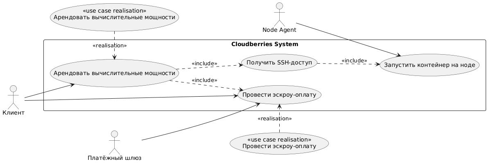

### *UC-2: Подключить и опубликовать ноду (Онбординг провайдера)*
Ядро предложения. Реализует Provider + Node Agent.

Фрагмент диаграммы реализации UC-2

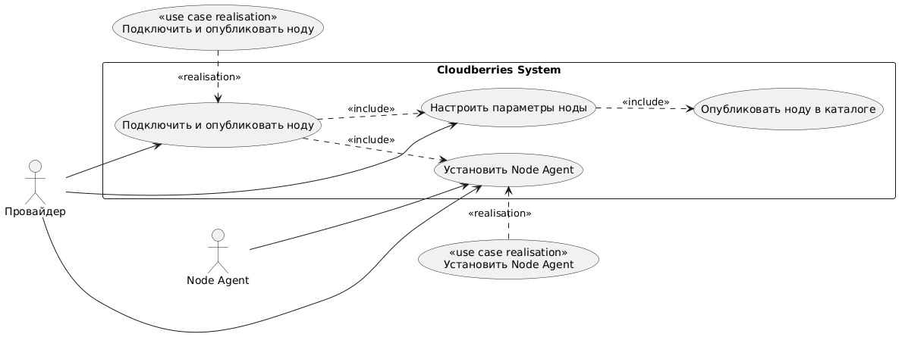

### *UC-3: Разрешить спор (Арбитраж)*
Trust Layer. Реализует Admin + Dispute Module.

Фрагмент диаграммы реализации UC-3

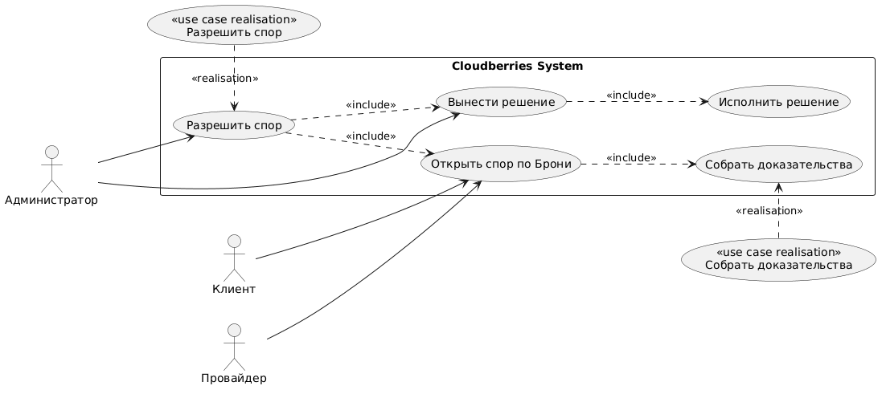

### *UC-4: Управление доступностью ноды и мониторинг доходов*
Операционное управление. Реализует Provider + Wallet/Schedule.

Фрагмент диаграммы реализации UC-4

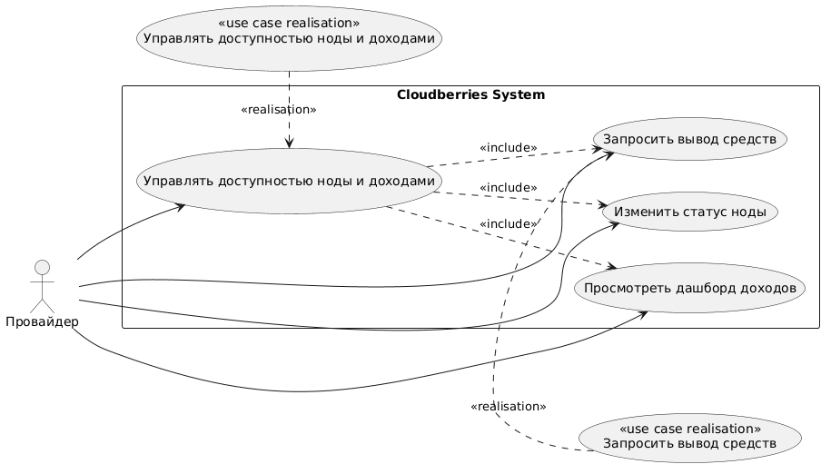

### Сводная диаграмма всех реализаций
Для полноты картины мы добавили общую диаграмму, показывающую все реализации в контексте системы:

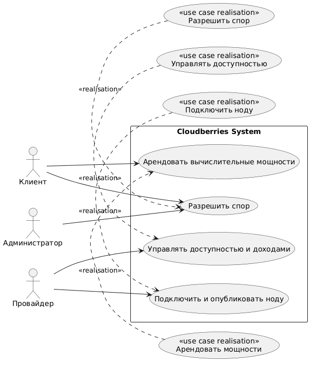

Это упрощенная Use Case диаграмма, так как в прошлой итерации эта диаграмма получилась громоздкой, было решено не тащить ее полностью сюда.

# 2. Диаграммы последовательности
Ниже представлены диаграммы последовательности для каждого из 4 выбранных вариантов использования. Они показывают взаимодействие акторов, граничных объектов, контроллеров и сущностей.

### *UC-1: Арендовать вычислительные мощности (Аренда с эскроу)*
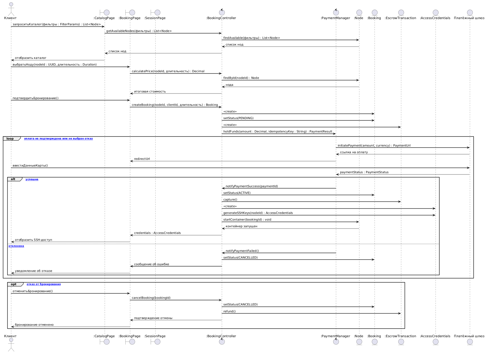

### *UC-2: Подключить и опубликовать ноду (Онбординг провайдера)*
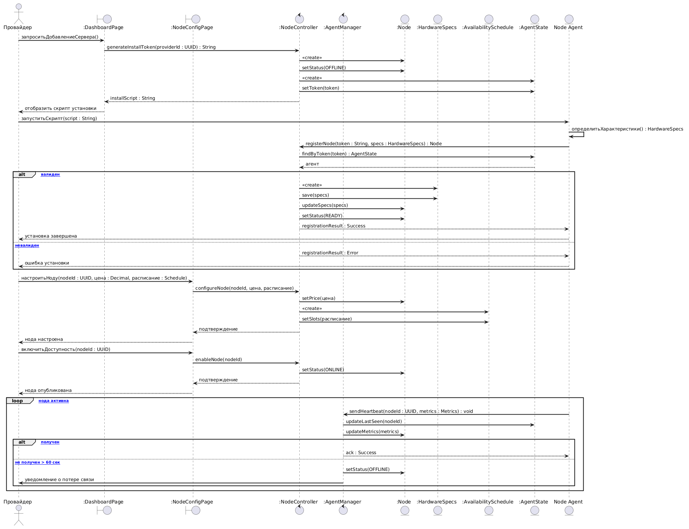

### *UC-3: Разрешить спор (Арбитраж)*
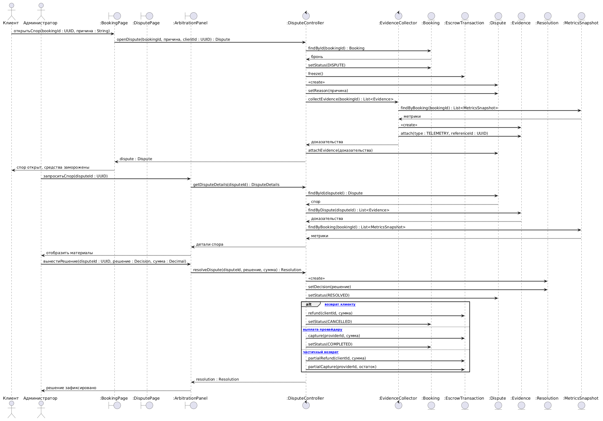

### *UC-4: Управление доступностью ноды и мониторинг доходов*
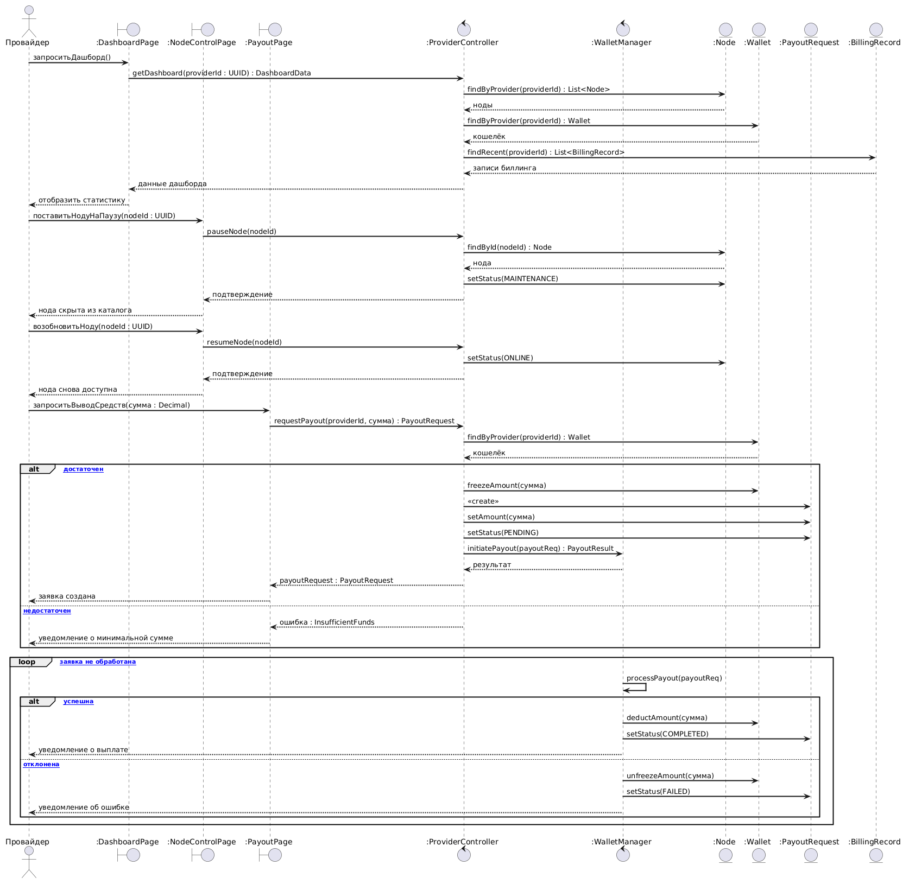

# 3. Проектная диаграмма классов
На основе диаграмм последовательности и концептуальной модели мы трансформируем классы в проектные.

### *UC-1: Арендовать вычислительные мощности (Аренда с эскроу)*

#### Основной успешный сценарий (Напоминалка из предыдущей итерации)
| Шаг | Действие актора | Ответ системы |
|:---|:---|:---|
| 1 | Клиент открывает каталог и задаёт параметры поиска (мощность, цена, регион) | Система отображает список доступных Нод с характеристиками и ценами |
| 2 | Клиент выбирает Ноду и указывает длительность аренды | Система рассчитывает итоговую стоимость (с учётом комиссии) и показывает её Клиенту |
| 3 | Клиент подтверждает бронирование | Система создаёт Бронь со статусом «Ожидает оплаты» и резервирует Ноду |
| 4 | — | Система передаёт Платёжному шлюзу запрос на холдирование средств |
| 5 | Клиент вводит платёжные данные и подтверждает оплату | Платёжный шлюз замораживает средства и возвращает системе подтверждение |
| 6 | — | Система переводит Бронь в статус «Активна», создаёт Эскроу-транзакцию |
| 7 | — | Система генерирует Учётные данные для доступа (IP, SSH-ключ) |
| 8 | — | Система передаёт Ноду команду на запуск контейнера для Клиента |
| 9 | Клиент получает SSH-доступ и начинает работу | Система запускает поминутный учёт использования |
| 10 | По истечении времени аренды (или по команде Клиента) | Система завершает Бронь, списывает фактическую сумму в пользу Провайдера, возвращает остаток Клиенту |

#### Трассировка: Шаг → Класс → Операция
| Шаг сценария | Класс | Операция (сигнатура) | Описание |
|:---|:---|:---|:---|
| 1 | `CatalogService` | `+searchNodes(filters: SearchFilters): List<Node>` | Поиск нод по фильтрам (GPU, RAM, цена, регион) |
| 1 | `Node` | `+isAvailable(): boolean` | Проверка доступности ноды |
| 2 | `PricingService` | `+calculatePrice(node: Node, duration: Duration): Money` | Расчёт стоимости с учётом комиссии |
| 3 | `BookingService` | `+createBooking(clientId: UUID, nodeId: UUID, duration: Duration): Booking` | Создание брони со статусом Pending |
| 3 | `Node` | `+reserve(): void` | Резервирование ноды (смена статуса на Busy) |
| 4 | `PaymentGateway` | `+holdFunds(amount: Money, idempotencyKey: String): PaymentResult` | Запрос на холдирование средств |
| 5 | `PaymentGateway` | `+confirmPayment(paymentId: UUID): PaymentStatus` | Подтверждение оплаты от шлюза |
| 6 | `Booking` | `+activate(): void` | Перевод брони в статус Active |
| 6 | `EscrowTransaction` | `+capture(): void` | Фиксация эскроу-транзакции |
| 7 | `AccessCredentials` | `+generate(node: Node, booking: Booking): AccessCredentials` | Генерация SSH-ключей и IP |
| 8 | `NodeAgentClient` | `+startContainer(nodeId: UUID, credentials: AccessCredentials): void` | Команда на запуск контейнера |
| 9 | `BillingService` | `+startMinuteBilling(bookingId: UUID): void` | Запуск поминутного биллинга |
| 10 | `Booking` | `+complete(): void` | Завершение брони |
| 10 | `EscrowTransaction` | `+distribute(clientShare: Money, providerShare: Money, platformFee: Money): void` | Распределение средств |

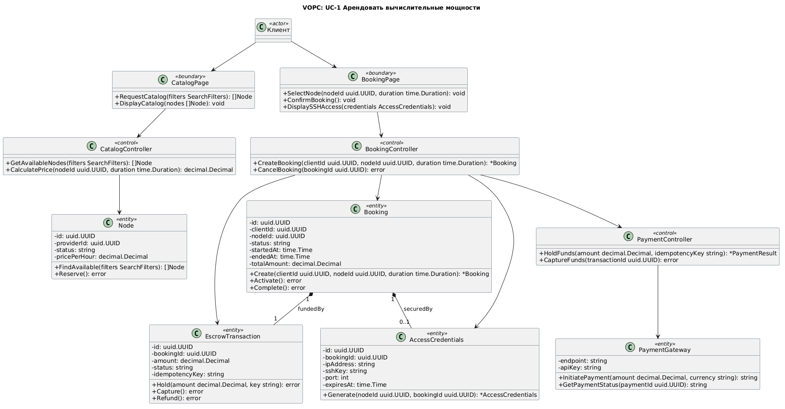

### *UC-2: Подключить и опубликовать ноду (Онбординг провайдера)*

#### Основной успешный сценарий (Напоминалка из предыдущей итерации)
| Шаг | Действие актора | Ответ системы |
|:---|:---|:---|
| 1 | Провайдер заходит в личный кабинет и инициирует добавление сервера | Система генерирует уникальный токен установки и скрипт подключения |
| 2 | Провайдер запускает скрипт на своём сервере | Node Agent устанавливается и определяет характеристики оборудования |
| 3 | — | Node Agent передаёт характеристики в Систему |
| 4 | — | Система создаёт запись Ноды со статусом «Неактивна» |
| 5 | Провайдер устанавливает цену за час и расписание доступности | Система сохраняет настройки |
| 6 | Провайдер включает доступность Ноды | Система переводит Ноду в статус «Доступна» и публикует в каталоге |
| 7 | — | Node Agent начинает отправлять сигналы готовности (heartbeat) |
| 8 | Поступает заказ от Клиента (UC-1) | Система передаёт Ноду команду на запуск контейнера |
| 9 | — | Node Agent запускает контейнер и начинает передавать телеметрию |
| 10 | Сессия завершается | Система начисляет доход на счёт Провайдера |
| 11 | Провайдер инициирует вывод средств | Система переводит деньги на карту Провайдера |

#### Трассировка: Шаг → Класс → Операция
| Шаг сценария | Класс | Операция (сигнатура) | Описание |
|:---|:---|:---|:---|
| 1 | `NodeService` | `+generateInstallToken(providerId: UUID): String` | Генерация одноразового токена |
| 1 | `AgentState` | `+create(token: String): AgentState` | Создание записи агента |
| 2 | `NodeAgent` | `+determineHardwareSpecs(): HardwareSpecs` | Автоопределение железа |
| 3 | `NodeAgent` | `+registerNode(token: String, specs: HardwareSpecs): Node` | Регистрация ноды |
| 4 | `Node` | `+create(providerId: UUID, specs: HardwareSpecs): Node` | Создание ноды со статусом Inactive |
| 5 | `Node` | `+configure(price: Decimal, schedule: AvailabilitySchedule): void` | Настройка цены и расписания |
| 6 | `Node` | `+enable(): void` | Включение доступности (статус Online) |
| 6 | `CatalogCache` | `+publishNode(node: Node): void` | Публикация в кэш каталога |
| 7 | `NodeAgent` | `+sendHeartbeat(metrics: Metrics): void` | Отправка heartbeat |
| 7 | `AgentState` | `+updateLastSeen(): void` | Обновление времени последнего heartbeat |
| 8 | `BookingService` | `+assignNode(booking: Booking, node: Node): void` | Назначение ноды на бронь |
| 9 | `NodeAgent` | `+startContainer(booking: Booking): void` | Запуск контейнера |
| 9 | `TelemetryService` | `+recordMetrics(nodeId: UUID, metrics: Metrics): void` | Запись телеметрии |
| 10 | `BillingService` | `+creditProvider(providerId: UUID, amount: Decimal): void` | Начисление дохода |
| 11 | `Wallet` | `+requestPayout(amount: Decimal): PayoutRequest` | Запрос на выплату |
| 11 | `PayoutService` | `+processPayout(request: PayoutRequest): void` | Обработка выплаты |

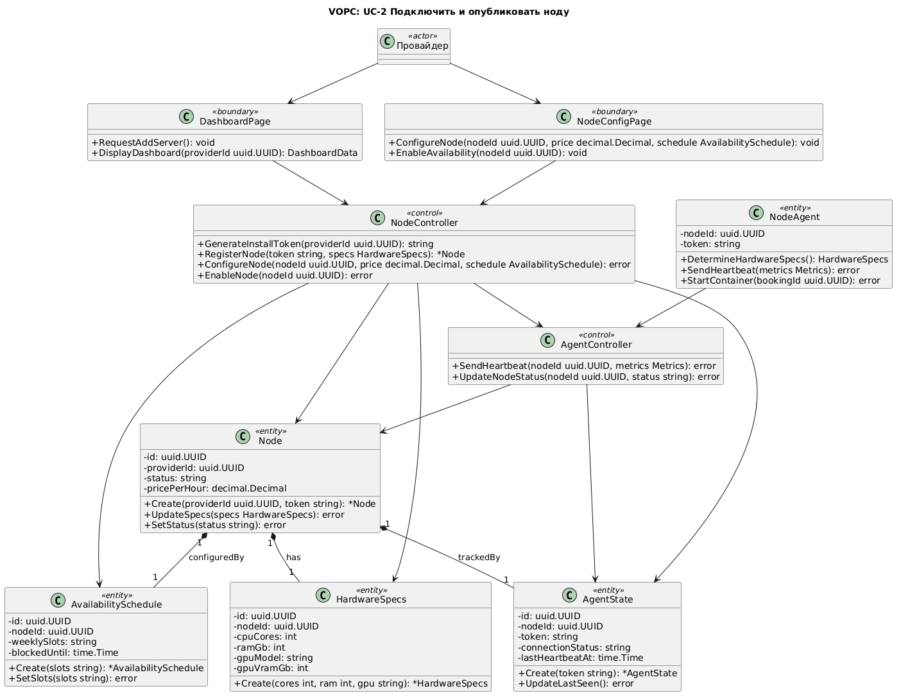

### *UC-3: Разрешить спор (Арбитраж)*

#### Основной успешный сценарий (Напоминалка из предыдущей итерации)
| Шаг | Действие актора | Ответ системы |
|:---|:---|:---|
| 1 | Клиент (или Провайдер) инициирует спор по конкретной Брони | Система переводит Бронь в статус «Спор», замораживает Эскроу-транзакцию |
| 2 | — | Система автоматически собирает доказательства: снапшоты Телеметрии за период аренды, историю команд, логи |
| 3 | — | Система уведомляет обе стороны об открытии спора |
| 4 | Администратор открывает панель арбитража | Система отображает детали Брони, характеристики Ноды, графики Телеметрии, переписку сторон |
| 5 | Администратор изучает материалы и выносит решение | Система фиксирует решение (возврат Клиенту / выплата Провайдеру / частичное распределение) |
| 6 | — | Система исполняет решение: переводит средства согласно вердикту |
| 7 | — | Система обновляет репутацию виновной стороны |
| 8 | — | Система уведомляет обе стороны о результате |

#### Трассировка: Шаг → Класс → Операция
| Шаг сценария | Класс | Операция (сигнатура) | Описание |
|:---|:---|:---|:---|
| 1 | `DisputeService` | `+openDispute(bookingId: UUID, reason: String, raisedBy: UUID): Dispute` | Открытие спора |
| 1 | `Booking` | `+markAsDisputed(): void` | Перевод брони в статус Dispute |
| 1 | `EscrowTransaction` | `+freeze(): void` | Заморозка эскроу |
| 2 | `EvidenceCollector` | `+collectEvidence(bookingId: UUID): List<Evidence>` | Сбор доказательств |
| 2 | `TelemetryService` | `+getMetricsForPeriod(nodeId: UUID, from: DateTime, to: DateTime): List<Metrics>` | Получение телеметрии за период |
| 3 | `NotificationService` | `+sendDisputeOpened(disputeId: UUID, parties: List<UUID>): void` | Уведомление сторон |
| 4 | `DisputeService` | `+getDisputeDetails(disputeId: UUID): DisputeDetails` | Получение деталей спора |
| 5 | `Dispute` | `+resolve(decision: DecisionEnum, amount: Decimal): Resolution` | Вынесение решения |
| 6 | `EscrowTransaction` | `+executeResolution(resolution: Resolution): void` | Исполнение решения |
| 7 | `ReputationService` | `+updateReputation(nodeId: UUID, interruptionRate: Decimal): void` | Обновление репутации |
| 8 | `NotificationService` | `+sendDisputeResolved(disputeId: UUID, resolution: Resolution): void` | Уведомление о результате |

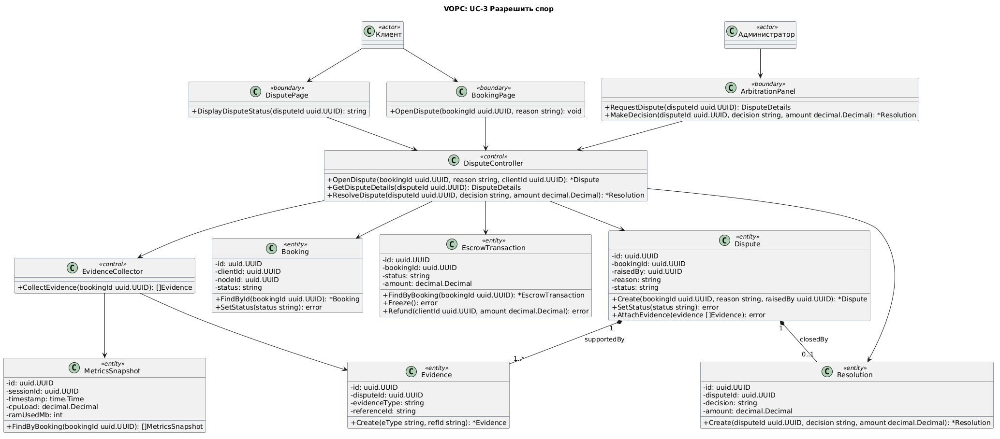

### *UC-4: Управление доступностью ноды и мониторинг доходов*

#### Основной успешный сценарий (Напоминалка из предыдущей итерации)
| Шаг | Действие актора | Ответ системы |
|:---|:---|:---|
| 1 | Провайдер открывает личный кабинет | Система отображает дашборд с списком нод, балансом и статистикой доходов |
| 2 | Провайдер выбирает ноду для управления | Система показывает детали ноды: статус, текущую аренду, расписание |
| 3 | Провайдер ставит ноду на паузу (или возобновляет) | Система изменяет статус ноды и скрывает/показывает её в каталоге |
| 4 | Провайдер запрашивает вывод средств | Система проверяет баланс и создаёт заявку на выплату |
| 5 | — | Система переводит средства на карту Провайдера в течение 24 часов |
| 6 | Провайдер просматривает историю транзакций | Система отображает детализацию всех начислений и выплат |

#### Трассировка: Шаг → Класс → Операция
| Шаг сценария | Класс | Операция (сигнатура) | Описание |
|:---|:---|:---|:---|
| 1 | `ProviderDashboardService` | `+getDashboard(providerId: UUID): DashboardData` | Получение данных дашборда |
| 2 | `NodeService` | `+getNodeDetails(nodeId: UUID): NodeDetails` | Получение деталей ноды |
| 3 | `Node` | `+pause(): void` | Пауза ноды (статус Maintenance) |
| 3 | `Node` | `+resume(): void` | Возобновление ноды (статус Online) |
| 3 | `CatalogCache` | `+unpublishNode(nodeId: UUID): void` | Скрытие из каталога |
| 4 | `Wallet` | `+checkBalance(providerId: UUID): Decimal` | Проверка баланса |
| 4 | `Wallet` | `+requestPayout(amount: Decimal): PayoutRequest` | Создание заявки на выплату |
| 5 | `PayoutService` | `+processPayout(request: PayoutRequest): void` | Обработка выплаты |
| 6 | `TransactionHistoryService` | `+getHistory(providerId: UUID, from: DateTime, to: DateTime): List<Transaction>` | Получение истории транзакций |

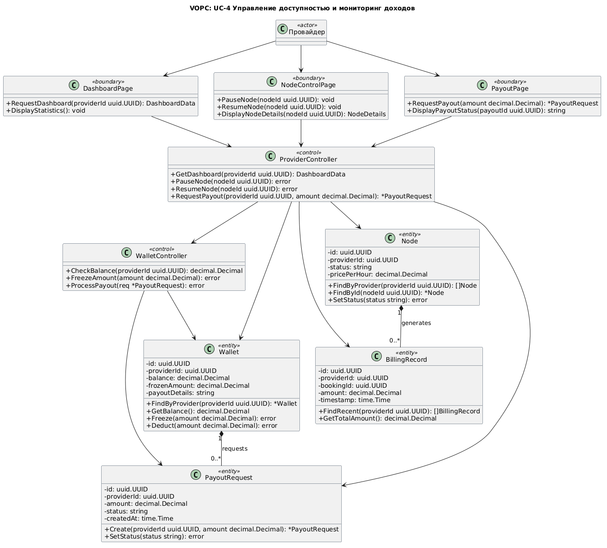

# Сводная таблица классов Cloudberries
После создания VOPC-диаграмм для каждого Use Case в отдельности, мы объединенили их в единую проектную модель системы.

#### Boundary-классы (Интерфейсы)

| Класс | Стереотип | Атрибуты | Ключевые операции | Use Case |
|:---|:---|:---|:---|:---|
| `CatalogPage` | `<<boundary>>` | — | `+ RequestCatalog(filters SearchFilters): []Node` `+ DisplayCatalog(nodes []Node): void` | UC-1 |
| `BookingPage` | `<<boundary>>` | — | `+ SelectNode(nodeId uuid.UUID, duration time.Duration): void` `+ ConfirmBooking(): void` `+ DisplaySSHAccess(credentials AccessCredentials): void` `+ OpenDispute(bookingId uuid.UUID, reason string): void` | UC-1, UC-3 |
| `DashboardPage` | `<<boundary>>` | — | `+ RequestAddServer(): void` `+ DisplayDashboard(providerId uuid.UUID): DashboardData` `+ RequestDashboard(providerId uuid.UUID): DashboardData` `+ DisplayStatistics(): void` | UC-2, UC-4 |
| `NodeConfigPage` | `<<boundary>>` | — | `+ ConfigureNode(nodeId uuid.UUID, price decimal.Decimal, schedule AvailabilitySchedule): void` `+ EnableAvailability(nodeId uuid.UUID): void` | UC-2 |
| `DisputePage` | `<<boundary>>` | — | `+ DisplayDisputeStatus(disputeId uuid.UUID): string` | UC-3 |
| `ArbitrationPanel` | `<<boundary>>` | — | `+ RequestDispute(disputeId uuid.UUID): DisputeDetails` `+ MakeDecision(disputeId uuid.UUID, decision string, amount decimal.Decimal): *Resolution` | UC-3 |
| `NodeControlPage` | `<<boundary>>` | — | `+ PauseNode(nodeId uuid.UUID): void` `+ ResumeNode(nodeId uuid.UUID): void` `+ DisplayNodeDetails(nodeId uuid.UUID): NodeDetails` | UC-4 |
| `PayoutPage` | `<<boundary>>` | — | `+ RequestPayout(amount decimal.Decimal): *PayoutRequest` `+ DisplayPayoutStatus(payoutId uuid.UUID): string` | UC-4 |

#### Control-классы (Контроллеры)

| Класс | Стереотип | Ключевые операции | Use Case |
|:---|:---|:---|:---|
| `CatalogController` | `<<control>>` | `+ GetAvailableNodes(filters SearchFilters): []Node` `+ CalculatePrice(nodeId uuid.UUID, duration time.Duration): decimal.Decimal` | UC-1 |
| `BookingController` | `<<control>>` | `+ CreateBooking(clientId uuid.UUID, nodeId uuid.UUID, duration time.Duration): *Booking` `+ CancelBooking(bookingId uuid.UUID): error` | UC-1 |
| `PaymentController` | `<<control>>` | `+ HoldFunds(amount decimal.Decimal, idempotencyKey string): *PaymentResult` `+ CaptureFunds(transactionId uuid.UUID): error` | UC-1 |
| `NodeController` | `<<control>>` | `+ GenerateInstallToken(providerId uuid.UUID): string` `+ RegisterNode(token string, specs HardwareSpecs): *Node` `+ ConfigureNode(nodeId uuid.UUID, price decimal.Decimal, schedule AvailabilitySchedule): error` `+ EnableNode(nodeId uuid.UUID): error` | UC-2 |
| `AgentController` | `<<control>>` | `+ SendHeartbeat(nodeId uuid.UUID, metrics Metrics): error` `+ UpdateNodeStatus(nodeId uuid.UUID, status string): error` | UC-2 |
| `DisputeController` | `<<control>>` | `+ OpenDispute(bookingId uuid.UUID, reason string, clientId uuid.UUID): *Dispute` `+ GetDisputeDetails(disputeId uuid.UUID): DisputeDetails` `+ ResolveDispute(disputeId uuid.UUID, decision string, amount decimal.Decimal): *Resolution` | UC-3 |
| `EvidenceCollector` | `<<control>>` | `+ CollectEvidence(bookingId uuid.UUID): []Evidence` | UC-3 |
| `ProviderController` | `<<control>>` | `+ GetDashboard(providerId uuid.UUID): DashboardData` `+ PauseNode(nodeId uuid.UUID): error` `+ ResumeNode(nodeId uuid.UUID): error` `+ RequestPayout(providerId uuid.UUID, amount decimal.Decimal): *PayoutRequest` | UC-4 |
| `WalletController` | `<<control>>` | `+ CheckBalance(providerId uuid.UUID): decimal.Decimal` `+ FreezeAmount(amount decimal.Decimal): error` `+ ProcessPayout(req *PayoutRequest): error` | UC-4 |

#### Entity-классы (Сущности)

| Класс | Стереотип | Ключевые атрибуты | Ключевые операции | Use Case |
|:---|:---|:---|:---|:---|
| `Node` | `<<entity>>` | `id`, `providerId`, `status`, `pricePerHour` | `+ FindAvailable()`, `+ Reserve()`, `+ Create()`, `+ SetStatus()` | UC-1, UC-2, UC-4 |
| `Booking` | `<<entity>>` | `id`, `clientId`, `nodeId`, `status`, `startedAt`, `endedAt`, `totalAmount` | `+ Create()`, `+ Activate()`, `+ Complete()`, `+ SetStatus()` | UC-1, UC-3 |
| `EscrowTransaction` | `<<entity>>` | `id`, `bookingId`, `amount`, `status`, `idempotencyKey` | `+ Hold()`, `+ Capture()`, `+ Refund()`, `+ Freeze()` | UC-1, UC-3 |
| `AccessCredentials` | `<<entity>>` | `id`, `bookingId`, `ipAddress`, `sshKey`, `port`, `expiresAt` | `+ Generate()` | UC-1 |
| `PaymentGateway` | `<<entity>>` | `endpoint`, `apiKey` | `+ InitiatePayment()`, `+ GetPaymentStatus()` | UC-1 |
| `HardwareSpecs` | `<<entity>>` | `id`, `nodeId`, `cpuCores`, `ramGb`, `gpuModel`, `gpuVramGb` | `+ Create()` | UC-2 |
| `AvailabilitySchedule` | `<<entity>>` | `id`, `nodeId`, `weeklySlots`, `blockedUntil` | `+ Create()`, `+ SetSlots()` | UC-2 |
| `AgentState` | `<<entity>>` | `id`, `nodeId`, `token`, `connectionStatus`, `lastHeartbeatAt` | `+ Create()`, `+ UpdateLastSeen()` | UC-2 |
| `NodeAgent` | `<<entity>>` | `nodeId`, `token` | `+ DetermineHardwareSpecs()`, `+ SendHeartbeat()`, `+ StartContainer()` | UC-2 |
| `Dispute` | `<<entity>>` | `id`, `bookingId`, `raisedBy`, `reason`, `status` | `+ Create()`, `+ SetStatus()`, `+ AttachEvidence()` | UC-3 |
| `Evidence` | `<<entity>>` | `id`, `disputeId`, `evidenceType`, `referenceId` | `+ Create()` | UC-3 |
| `Resolution` | `<<entity>>` | `id`, `disputeId`, `decision`, `amount` | `+ Create()` | UC-3 |
| `MetricsSnapshot` | `<<entity>>` | `id`, `sessionId`, `timestamp`, `cpuLoad`, `ramUsedMb` | `+ FindByBooking()` | UC-3 |
| `Wallet` | `<<entity>>` | `id`, `providerId`, `balance`, `frozenAmount`, `payoutDetails` | `+ FindByProvider()`, `+ GetBalance()`, `+ Freeze()`, `+ Deduct()` | UC-4 |
| `PayoutRequest` | `<<entity>>` | `id`, `providerId`, `amount`, `status`, `createdAt` | `+ Create()`, `+ SetStatus()` | UC-4 |
| `BillingRecord` | `<<entity>>` | `id`, `providerId`, `bookingId`, `amount`, `timestamp` | `+ FindRecent()`, `+ GetTotalAmount()` | UC-4 |

#### Акторы

| Класс | Стереотип | Роль | Use Case |
|:---|:---|:---|:---|
| `Клиент` | `<<actor>>` | Инициатор аренды и споров | UC-1, UC-3 |
| `Провайдер` | `<<actor>>` | Владелец оборудования, инициатор онбординга и выплат | UC-2, UC-4 |
| `Администратор` | `<<actor>>` | Арбитр споров | UC-3 |

#### Статистика классов

| Категория | Количество | Доля |
|:---|:---|:---|
| **Boundary** (UI) | 8 | 22% |
| **Control** (Логика) | 9 | 25% |
| **Entity** (Данные) | 16 | 44% |
| **Actor** (Пользователи) | 3 | 9% |
| **Итого** | **36 классов** | 100% |