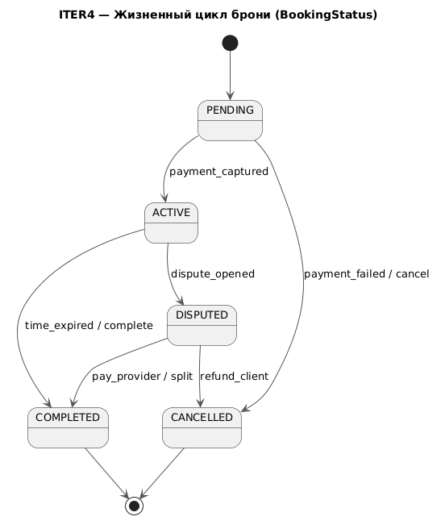
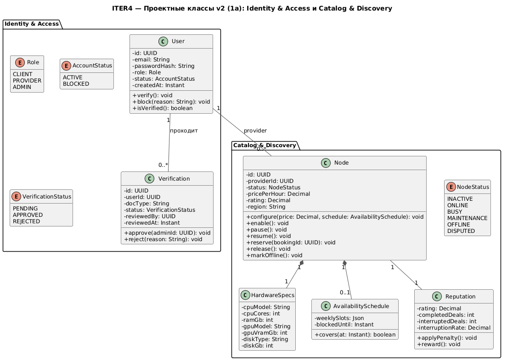
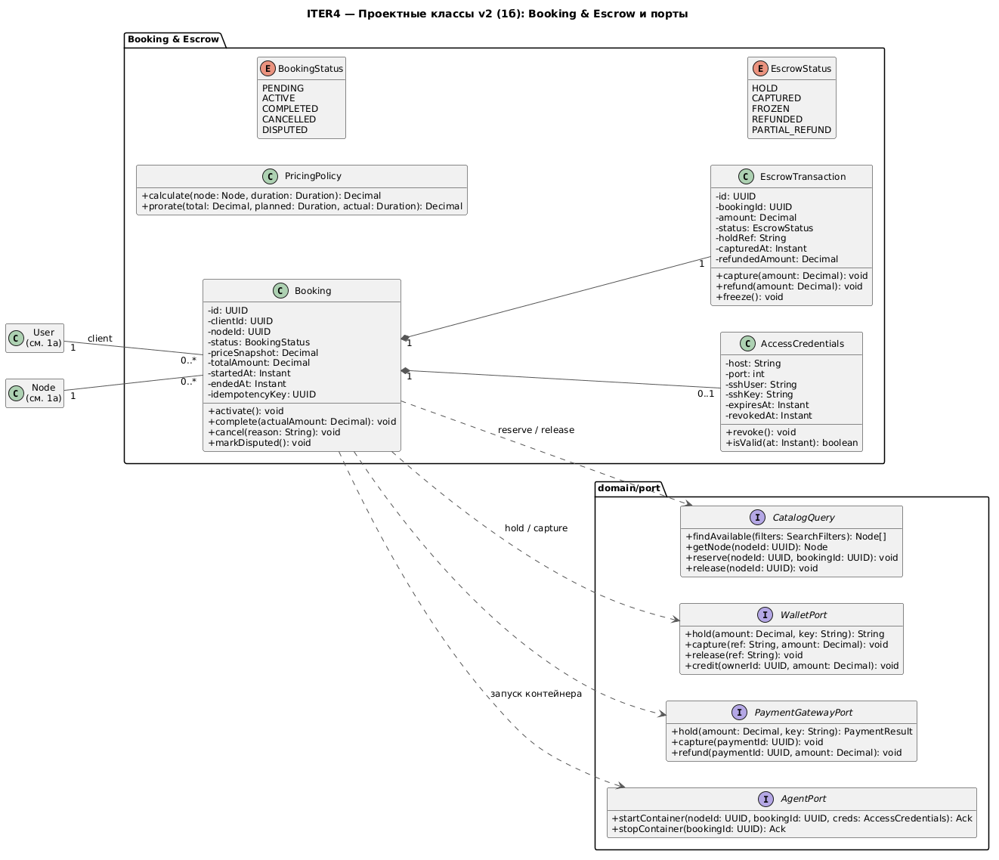
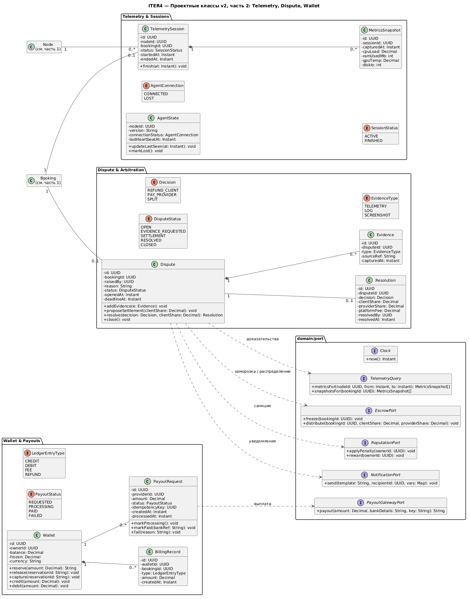
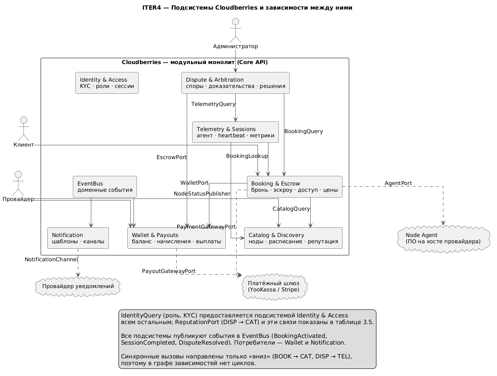
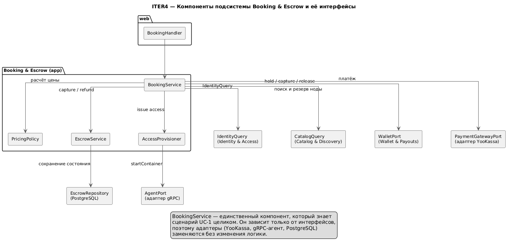
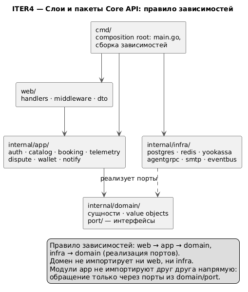
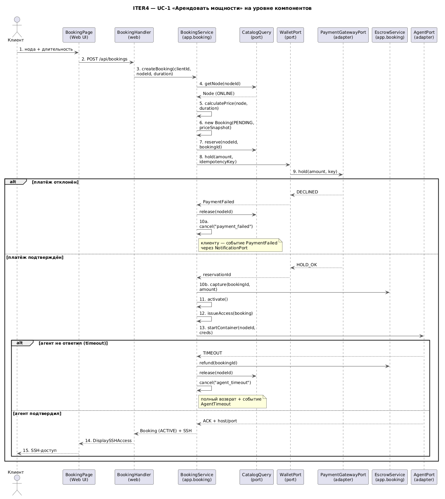

# 1. Работа над ошибками итерации 3

## 1.1. Как проверялась модель

Модель И3 проверялась по четырём критериям:

1. **Согласованность трассировок.** Каждая операция из таблиц «шаг → класс → операция» должна существовать в сводной таблице классов, и наоборот.
2. **Корректность стереотипов.** `<<entity>>` — данные с идентичностью, `<<control>>` — сценарий, `<<boundary>>` — интерфейс с актором; внешние системы не могут быть сущностями.
3. **Статусы.** Состояния должны быть перечислениями с явными переходами, а не строковыми полями.

## 1.2. Найденные ошибки и исправления

| № | Что было в И3 | Почему это ошибка | Исправление в v2 |
|:---|:---|:---|:---|
| 1 | Класс `PaymentGateway` со стереотипом `<<entity>>`, с полями `endpoint`, `apiKey` | Платёжный шлюз — внешняя система (в И2 он вторичный актор). Сущность не может хранить API-ключ и «обрабатывать платежи» | Удалён; введён порт `PaymentGatewayPort` (домен) и адаптер `YooKassaAdapter` (инфраструктура) |
| 2 | Трассировки ссылались на `BookingService`, `NodeAgentClient`, `CatalogCache`, `TransactionHistoryService`, `ReputationService`, `NotificationService`, а в сводных таблицах были `BookingController`, `CatalogController` и часть классов отсутствовала | Модель противоречила сама себе: одни и те же обязанности назывались по-разному, часть операций не имела класса | Введён единый реестр классов (п. 1.4). Разделены `*Handler` (web-адаптер, не проектный класс) и `*Service` (прикладной сервис). Все операции трассируются на существующие классы |
| 3 | Не было домена Identity: ни `User`, ни `Role`, ни `Verification`, хотя все ВИ в И2 имеют предусловие «пользователь зарегистрирован и прошёл KYC» | Ни один сценарий не может начаться: акторы и роли не смоделированы, KYC-статус нигде не хранится | Добавлены сущности `User`, `Verification`, перечисления `Role`, `AccountStatus`, `VerificationStatus`; добавлен ВИ UC-0 (п. 2.2) |
| 4 | Статусы — строки (`status: string`), дублирование: `Wallet.Freeze()` и `EscrowTransaction.Freeze()`, у `Node` одновременно `Reserve()`, `pause()`, `resume()`, `SetStatus()` | Невозможно проверить допустимость перехода; две сущности меняют одно и то же состояние денег | Введены перечисления `BookingStatus`, `NodeStatus`, `EscrowStatus`, `DisputeStatus`, `PayoutStatus` (таблица переходов — п. 2.4). Заморозка средств — только `EscrowService`, кошелёк меняется через `WalletPort` |
| 5 | Модель и БД расходились: у `Booking` были `startedAt`/`endedAt`, в таблице `bookings` только `created_at`; у `MetricsSnapshot` не было `gpuTemp`, `diskIo`; `AccessCredentials` в БД хранит `ssh_login`/`ssh_pass`, в модели — `sshKey` | Проектная модель не отображается в схему, значит код придётся писать «по памяти» | Канонические атрибуты зафиксированы в v2; расхождения вынесены в список миграций (п. 4.2) |
| 6 | Фабричные операции на сущностях: `Node.Create()`, `Booking.Create()`, `AccessCredentials.Generate()` как операции самих сущностей | Нарушение GRASP Creator: создание — ответственность сервиса/репозитория, сущность должна отвечать только за свои переходы состояния | `Create`/`Generate` перенесены в `BookingService`, `AccessProvisioner`, репозитории; у сущностей остались `activate()`, `complete()`, `cancel()`, `reserve()`, `release()` |
| 7 | Альтернативы UC-1 «5а отказ платежа» и «8а таймаут агента» описаны в И2, но в модели нет ни одной операции отката | Сценарий, описанный в требованиях, не реализуем: деньги остаются замороженными, нода — занятой | Добавлены `EscrowService.refund`, `Booking.cancel(reason)`, `Node.release`, события компенсации; отражено на диаграмме последовательности (п. 3.6) |
| 8 | Внешние зависимости вызывались напрямую (`NodeAgentClient`, `NotificationService`, `Clock`) | Домен зависел от инфраструктуры: нельзя заменить шлюз или протестировать логику без сети | Введены порты `AgentPort`, `NotificationPort`, `Clock`; все внешние системы — за адаптерами |
| 9 | `EvidenceCollector` и `TelemetryService` дублировали сбор телеметрии; `ReputationService` менял рейтинг, хотя владелец данных — каталог | Два класса пишут в одни данные — рассинхронизация; рейтинг относится к каталогу | `EvidenceService` использует `TelemetryQuery` (только чтение); рейтинг меняется через `ReputationPort`, реализуемый каталогом |
| 10 | Не было модели выплат: `PayoutRequest` без статусов и идемпотентности, шаг «перевод в течение 24 часов» нигде не отражён | Повторный запрос на вывод мог бы списать средства дважды | Добавлены `PayoutStatus`, `idempotencyKey`, `PayoutService`, `PayoutGatewayPort`; повтор обрабатывается по ключу |

## 1.3. Что изменилось в модели

- **Удалено:** `PaymentGateway` (`<<entity>>`), `NodeAgent` (`<<entity>>` — это ПО на хосте, а не сущность домена).
- **Добавлено:** домен **Identity & Access** (`User`, `Verification`, `Role`), домен **Wallet & Payouts** (`Wallet`, `BillingRecord`, `PayoutRequest`), сущность `Resolution`, 13 перечислений вместо строковых статусов, 14 портов.
- **Переименовано:** `*Controller` → `*Service` (прикладной слой) + `*Handler` (web-адаптер); `EvidenceCollector` → `EvidenceService`; `CatalogCache` → `CatalogIndex`.
- **Уточнено:** у всех операций появились типы параметров и возвращаемых значений; связи получили кратности и роли; состояния вынесены в перечисления.

## 1.4. Реестр классов v2

| Подсистема | Boundary | Control | Entity | Enum | Port |
|:---|:---|:---|:---|:---|:---|
| Identity & Access | `LoginPage` | `AuthService` | `User`, `Verification` | `Role`, `AccountStatus`, `VerificationStatus` | `IdentityQuery` |
| Catalog & Discovery | `CatalogPage` | `CatalogService`, `PricingPolicy` | `Node`, `HardwareSpecs`, `AvailabilitySchedule`, `Reputation` | `NodeStatus` | `CatalogQuery`, `NodeStatusPublisher` |
| Booking & Escrow | `BookingPage` | `BookingService`, `EscrowService`, `AccessProvisioner` | `Booking`, `EscrowTransaction`, `AccessCredentials` | `BookingStatus`, `EscrowStatus` | `WalletPort`, `PaymentGatewayPort`, `AgentPort` |
| Telemetry & Sessions | — (gRPC-шлюз) | `TelemetryService`, `HeartbeatMonitor` | `AgentState`, `TelemetrySession`, `MetricsSnapshot` | `AgentConnection`, `SessionStatus` | `TelemetryQuery`, `BookingLookup` |
| Dispute & Arbitration | `DisputePage`, `ArbitrationPanel` | `DisputeService`, `EvidenceService` | `Dispute`, `Evidence`, `Resolution` | `DisputeStatus`, `Decision`, `EvidenceType` | `EscrowPort`, `ReputationPort` |
| Wallet & Payouts | `DashboardPage`, `PayoutPage`, `NodeControlPage` | `WalletService`, `BillingService`, `PayoutService` | `Wallet`, `BillingRecord`, `PayoutRequest` | `PayoutStatus`, `LedgerEntryType` | `PayoutGatewayPort` |
| Notification | — | `NotificationService` | — | — | `NotificationPort` |
| Инфраструктурные (общие) | — | — | — | — | `EventBus`, `Clock` |
| **Итого** | **8** | **14** | **18** | **13** | **14** |

Плюс 3 актора (`Клиент`, `Провайдер`, `Администратор`) = 70 элементов проектной модели против 36 в И3. Рост объясняется появлением двух отсутствовавших доменов, перечислений вместо строк и явных интерфейсов вместо прямых вызовов.

# 2. Полнота реализаций вариантов использования

## 2.1. Что было покрыто и что добавлено

| ВИ | Шагов в И2 | Альтернатив в И2 | Покрыто в И3 | Достроено в И4 |
|:---|:---|:---|:---|:---|
| UC-1 «Арендовать мощности» | 10 | 6 | 10 шагов, 2 ветки | ветки 5а, 8а, 9а + компенсации; завершение по времени (шаг 10) |
| UC-2 «Подключить и опубликовать ноду» | 11 | 4 | 11 шагов | 3а (ручной ввод характеристик), 7а (потеря heartbeat) |
| UC-3 «Разрешить спор» | 8 | 3 | 8 шагов | 1а (спор после завершения), 4а (мало данных), 5а (мировое) |
| UC-4 «Доступность и доходы» | 6 (спроектирован в И3) | — | 6 шагов | 4а (порог вывода), 5а (сбой выплаты) |
| **UC-0 «Регистрация и вход»** (новый) | 6 | 2 | — | спецификация и трассировка целиком (п. 2.2) |

UC-0 добавлен потому, что это предусловие всех остальных ВИ: без аутентификации, роли и KYC-статуса ни один сценарий не может начаться.

## 2.2. UC-0 «Зарегистрироваться и войти в систему»

**Акторы:** Пользователь (инициатор), Администратор (одобрение KYC).
**Цель:** пользователь получает аккаунт с ролью и, при необходимости, подтверждённую верификацию.
**Предусловия:** нет. **Постусловия:** создан `User`, создан `Wallet`, при запросе KYC — `Verification` в статусе `PENDING`.

| Шаг | Действие актора | Ответ системы | Класс | Операция |
|:---|:---|:---|:---|:---|
| 1 | Открывает форму регистрации | Показывает поля email, пароль, роль | `LoginPage` | `+submitRegistration(email: String, password: String, role: Role): void` |
| 2 | Вводит данные | Проверяет уникальность email, хэширует пароль (bcrypt) | `AuthService` | `+register(email: String, passwordHash: String, role: Role): User` |
| 3 | — | Сохраняет пользователя и открывает кошелёк | `UserRepository`, `WalletService` | `+save(user: User): void`, `+createOwnerWallet(ownerId: UUID): Wallet` |
| 4 | Провайдер загружает документы | Создаёт заявку на верификацию | `Verification` | `+submit(userId: UUID, docType: String): Verification` |
| 5 | Администратор одобряет | Меняет статус, помечает пользователя верифицированным | `Verification`, `User` | `+approve(adminId: UUID): void`, `+verify(): void` |
| 6 | Входит в систему | Проверяет пароль, выдаёт JWT с ролью | `AuthService` | `+login(email: String, password: String): Token` |

Альтернативы: 
**2а** — email уже занят (`AuthService` возвращает `EmailTaken`, форма показывает ошибку); 
**6а** — неверный пароль или заблокированный аккаунт (`AccountStatus = BLOCKED` → `AccessDenied`).

## 2.3. Достроенные альтернативные ветки

| ВИ | Ветка / шаг | Что добавлено в реализацию | Операции |
|:---|:---|:---|:---|
| UC-1 | 5а отказ платежа | Компенсация: снять резерв ноды, отменить бронь | `WalletPort.release(ref)`, `Booking.cancel(reason)`, `Node.release()`, событие `PaymentFailed` |
| UC-1 | 8а таймаут агента | Компенсация с полным возвратом, нода помечается недоступной | `EscrowService.refund(bookingId)`, `AgentPort.stopContainer`, `Node.markOffline()`, событие `AgentTimeout` |
| UC-1 | 9а досрочное завершение | Пропорциональный расчёт и возврат остатка | `PricingPolicy.prorate(total, planned, actual)`, `Booking.complete(actualAmount)`, `EscrowTransaction.refund(остаток)` |
| UC-1 | 10 завершение по времени | Списание фактической суммы, начисление провайдеру | `Booking.complete()`, `EscrowTransaction.capture()`, событие `BookingCompleted` → `BillingService` |
| UC-2 | 3а агент не определил характеристики | Ручной ввод с проверкой | `CatalogService.registerManual(specs)`, `HardwareSpecs` |
| UC-2 | 7а потеря heartbeat | Авто-перевод в `OFFLINE`, скрытие из каталога | `HeartbeatMonitor.sweep(now)`, `NodeStatusPublisher.markOffline(nodeId)` |
| UC-3 | 1а спор после завершения | Окно 24 часа, заморозка из уже закрытого эскроу | `Dispute` + `deadlineAt`, `EscrowPort.freeze(bookingId)` |
| UC-3 | 4а недостаточно данных | Запрос доказательств у сторон | `Dispute.addEvidence(e)`, статус `EVIDENCE_REQUESTED` |
| UC-3 | 5а мировое соглашение | Распределение по договорённости | `Dispute.proposeSettlement(clientShare)`, `Resolution` с `Decision.SPLIT` |
| UC-4 | 4а сумма ниже порога | Проверка минимальной суммы вывода | `WalletService.checkPayoutAllowed(amount)` |
| UC-4 | 5а сбой выплаты | Статус `FAILED`, повтор по тому же `idempotencyKey` | `PayoutRequest.fail(reason)`, `PayoutService.retry(id)` |

## 2.4. Жизненные циклы сущностей

Строковые статусы заменены перечислениями с явно допустимыми переходами:

| Сущность | Состояния | Допустимые переходы |
|:---|:---|:---|
| `Booking` | `PENDING`, `ACTIVE`, `COMPLETED`, `CANCELLED`, `DISPUTED` | `PENDING → ACTIVE` (оплата подтверждена); `PENDING → CANCELLED` (отказ/отмена); `ACTIVE → COMPLETED` (время истекло или клиент завершил); `ACTIVE → DISPUTED` (открыт спор); `DISPUTED → COMPLETED` (решение в пользу провайдера или раздел) |
| `EscrowTransaction` | `HOLD`, `CAPTURED`, `FROZEN`, `REFUNDED`, `PARTIAL_REFUND` | `HOLD → CAPTURED`; `HOLD → REFUNDED`; `CAPTURED → FROZEN` (спор); `FROZEN → REFUNDED / PARTIAL_REFUND / CAPTURED` |
| `Node` | `INACTIVE`, `ONLINE`, `BUSY`, `MAINTENANCE`, `OFFLINE`, `DISPUTED` | `INACTIVE → ONLINE`; `ONLINE → BUSY` (резерв); `BUSY → ONLINE` (освобождение); `ONLINE ↔ MAINTENANCE`; `ONLINE → OFFLINE` (нет heartbeat); `OFFLINE → ONLINE` (heartbeat вернулся) |
| `Dispute` | `OPEN`, `EVIDENCE_REQUESTED`, `SETTLEMENT`, `RESOLVED`, `CLOSED` | `OPEN → EVIDENCE_REQUESTED`; `OPEN → SETTLEMENT`; `EVIDENCE_REQUESTED → RESOLVED`; `SETTLEMENT → RESOLVED`; `RESOLVED → CLOSED` |
| `PayoutRequest` | `REQUESTED`, `PROCESSING`, `PAID`, `FAILED` | `REQUESTED → PROCESSING`; `PROCESSING → PAID`; `PROCESSING → FAILED`; `FAILED → REQUESTED` (повтор) |

Жизненный цикл брони (актуализирован: спор больше не терминальное состояние — после решения бронь закрывается):

## 2.5. Проектные классы v2

**Часть 1а — Identity & Access и Catalog & Discovery.** 
Появились `User`, `Verification`, `Role`, `AccountStatus`, `VerificationStatus`; у `Node` — явное перечисление `NodeStatus`, у `Reputation` — операции начисления санкций и поощрений.

**Часть 1б — Booking & Escrow и порты.** 
`Booking` хранит снимок цены (`priceSnapshot`), чтобы смена тарифа не меняла уже созданную бронь; `EscrowTransaction` отвечает за деньги, `AccessCredentials` — за доступ; все внешние зависимости скрыты за портами.

**Часть 2 — Telemetry, Dispute, Wallet.** 
`MetricsSnapshot` содержит `gpuTemp` и `diskIo`; у `Dispute` есть дедлайн, у `PayoutRequest` — идемпотентность и статусы.

---

# 3. Домены, подсистемы и компоненты

## 3.1. Подсистемы (ограниченные контексты)

Система разложена на 7 подсистем. Границы проведены по владению данными: каждая сущность имеет ровно одного владельца, а чужие данные доступны только через порт.

| Подсистема | Ответственность | Владеет сущностями | Отдаёт наружу (порт) | Потребляет |
|:---|:---|:---|:---|:---|
| **Identity & Access** | Регистрация, вход, роли, KYC, блокировки | `User`, `Verification` | `IdentityQuery` | — |
| **Catalog & Discovery** | Каталог нод, характеристики, расписание, рейтинг | `Node`, `HardwareSpecs`, `AvailabilitySchedule`, `Reputation` | `CatalogQuery`, `NodeStatusPublisher`, `ReputationPort` | `IdentityQuery` |
| **Booking & Escrow** | Бронь, расчёт цены, эскроу, выдача доступа | `Booking`, `EscrowTransaction`, `AccessCredentials` | `BookingLookup`, `EscrowPort` | `IdentityQuery`, `CatalogQuery`, `WalletPort`; адаптеры `PaymentGatewayPort`, `AgentPort` |
| **Telemetry & Sessions** | Heartbeat, телеметрия, привязка метрик к сессии | `AgentState`, `TelemetrySession`, `MetricsSnapshot` | `TelemetryQuery` | `IdentityQuery`, `BookingLookup`, `NodeStatusPublisher` |
| **Dispute & Arbitration** | Споры, доказательства, решения, репутационные санкции | `Dispute`, `Evidence`, `Resolution` | — | `IdentityQuery`, `BookingLookup`, `TelemetryQuery`, `EscrowPort`, `ReputationPort` |
| **Wallet & Payouts** | Баланс, начисления, выплаты | `Wallet`, `BillingRecord`, `PayoutRequest` | `WalletPort` | `IdentityQuery`, `PayoutGatewayPort`; события `BookingCompleted` |
| **Notification** | Шаблоны и доставка уведомлений | — | `NotificationPort` | события из `EventBus` |

## 3.2. Компоненты подсистемы Booking & Escrow

Центральный сценарий (UC-1) проходит через Booking & Escrow, поэтому эта подсистема раскрыта до компонентов. Каждый компонент имеет одну причину изменения, а зависимости идут только к интерфейсам.

| Компонент | Слой | Ответственность | Зависит от |
|:---|:---|:---|:---|
| `BookingHandler` | web | Приём HTTP-запроса, валидация DTO, вызов сервиса | `BookingService` |
| `BookingService` | app | Сценарий UC-1 целиком: цена, резерв, эскроу, доступ, компенсации | `PricingPolicy`, `EscrowService`, `AccessProvisioner`, порты `CatalogQuery`, `WalletPort`, `PaymentGatewayPort`, `AgentPort`, `IdentityQuery` |
| `PricingPolicy` | app | Расчёт стоимости и пропорциональный пересчёт | `Node` (данные), `Clock` |
| `EscrowService` | app | Состояние эскроу: `HOLD → CAPTURED → REFUNDED`, заморозка при споре | `WalletPort`, `EscrowRepository` |
| `AccessProvisioner` | app | Генерация SSH-доступа с TTL, отзыв | `AgentPort`, `AccessCredentials` |

## 3.3. Пакеты и правило зависимостей

| Пакет | Содержимое | Может зависеть от | Не может зависеть от |
|:---|:---|:---|:---|
| `cmd/` | `main.go`, сборка зависимостей | `web`, `app`, `infra` | — |
| `web/` | handlers, middleware, DTO | `app` | `infra`, `domain` (напрямую) |
| `internal/app/` | прикладные сервисы по доменам | `domain` | `web`, `infra` |
| `internal/domain/` | сущности, перечисления, `port/` | ничего (только стандартная библиотека) | `web`, `app`, `infra` |
| `internal/infra/` | PostgreSQL, Redis, YooKassa, gRPC-агент, SMTP, EventBus | `domain` (реализует порты) | `app`, `web` |

## 3.4. Интерфейсы (порты)

| Порт | Реализует | Потребители | Операции |
|:---|:---|:---|:---|
| `IdentityQuery` | Identity & Access | все домены, кроме Notification | `user(id): User`, `requireRole(id, role): void`, `isVerified(id): boolean` |
| `CatalogQuery` | Catalog & Discovery | Booking, Dispute | `search(filters): Node[]`, `getNode(id): Node`, `reserve(nodeId, bookingId): void`, `release(nodeId): void` |
| `NodeStatusPublisher` | Catalog & Discovery | Telemetry | `markOnline(nodeId)`, `markBusy(nodeId)`, `markOffline(nodeId)` |
| `BookingLookup` | Booking & Escrow | Telemetry | `byId(id): Booking`, `activeByNode(nodeId): Booking`, `completedAfter(t): Booking[]` |
| `EscrowPort` | Booking & Escrow | Dispute | `freeze(bookingId): void`, `distribute(bookingId, clientShare, providerShare): void` |
| `WalletPort` | Wallet & Payouts | Booking | `hold(amount, key): String`, `capture(ref, amount): void`, `release(ref): void` |
| `PaymentGatewayPort` | инфраструктура (YooKassa) | Booking, Wallet | `hold(amount, key): PaymentResult`, `capture(paymentId): void`, `refund(paymentId, amount): void` |
| `PayoutGatewayPort` | инфраструктура | Wallet | `payout(amount, bankDetails, key): String` |
| `AgentPort` | инфраструктура (gRPC) | Booking | `startContainer(nodeId, bookingId, creds): Ack`, `stopContainer(bookingId): Ack` |
| `TelemetryQuery` | Telemetry & Sessions | Dispute | `metricsFor(nodeId, from, to): MetricsSnapshot[]`, `snapshotsFor(bookingId): MetricsSnapshot[]` |
| `ReputationPort` | Catalog & Discovery | Dispute | `applyPenalty(ownerId): void`, `reward(ownerId): void` |
| `NotificationPort` | Notification | все | `send(template, recipientId, vars): void` |
| `EventBus` | инфраструктура | все | `publish(event): void`, `subscribe(type, handler): void` |
| `Clock` | инфраструктура | все | `now(): Instant` |

`AgentPort` — важное решение: это порт **инфраструктуры**, а не Telemetry. Иначе Booking зависел бы от Telemetry, а Telemetry — от Booking (через `BookingLookup`), и получился бы цикл.

## 3.5. Матрица зависимостей и проверка на циклы

Строки — потребитель, столбцы — поставщик. В ячейках — порт, через который идёт обращение.

| потребитель / поставщик | Identity | Catalog | Wallet | Booking | Telemetry | Notification |
|:---|:---|:---|:---|:---|:---|:---|
| **Identity** | — | — | — | — | — | — |
| **Catalog** | `IdentityQuery` | — | — | — | — | — |
| **Wallet** | `IdentityQuery` | — | — | — | — | — |
| **Booking** | `IdentityQuery` | `CatalogQuery` | `WalletPort` | — | — | события |
| **Telemetry** | `IdentityQuery` | `NodeStatusPublisher` | — | `BookingLookup` | — | — |
| **Dispute** | `IdentityQuery` | `ReputationPort` | — | `BookingLookup`, `EscrowPort` | `TelemetryQuery` | — |
| **Notification** | — | — | — | события | — | — |

 Внешние системы (платёжный шлюз, Node Agent) подключены через адаптеры и не участвуют в графе доменов.

## 3.6. UC-1 на уровне компонентов

Диаграмма показывает, что сценарий проходит через интерфейсы, а компенсации (отказ платежа, таймаут агента) не оставляют систему в «подвисшем» состоянии.

Проверка: каждая стрелка на диаграмме соответствует операции из таблицы 3.4; ни один вызов не идёт напрямую в PostgreSQL, Redis или YooKassa — только через порт.

## 3.7. Архитектурные решения

#### ADR-001. Модульный монолит с границами по доменам.
**Контекст:** команда 3–4 человека, эскроу требует атомарности «списание + запись эскроу + смена статуса брони». 
**Решение:** один процесс на Go, одна БД, границы доменов соблюдаются правилом импортов. 
**Альтернативы:** микросервисы (нужны саги и распределённые транзакции), событийная архитектура (eventual consistency недопустима для денег). 
**Последствия:** масштабирование только целиком, но вырезание домена в сервис возможно без переписывания ядра.

#### ADR-002. Порты и адаптеры внутри монолита.
**Контекст:** платёжный шлюз, gRPC-агент и уведомления меняются чаще бизнес-логики. 
**Решение:** домен объявляет интерфейсы в `internal/domain/port`, инфраструктура их реализует, прикладной слой видит только интерфейсы. 
**Альтернатива:** прямой вызов клиентов из сервисов отвергнута, потому что делает невозможным тестирование сценария без сети. 
**Последствия:** +14 интерфейсов, но замена шлюза — это новый адаптер, а не правка сценария.

#### ADR-003. Синхронные вызовы вниз, события для обратных уведомлений.
**Контекст:** Wallet должен начислить провайдеру после завершения брони, а Booking не должен зависеть от Wallet в обе стороны. 
**Решение:** прямые вызовы только по направлению «потребитель -> поставщик»; обратные сценарии (начисление, письма, смена статуса ноды после heartbeat) идут через `EventBus`.
**Альтернатива:** двусторонние вызовы, но они дают цикл и жёсткую связность. 
**Последствия:** нужна идемпотентность обработчиков событий.

#### ADR-004. Идемпотентность денежных операций.
**Контекст:** таймаут сети или повторный вебхук могут продублировать платёж. 
**Решение:** `idempotencyKey` в `Booking`, `EscrowTransaction`, `PayoutRequest` + уникальный индекс в БД; адаптер шлюза передаёт ключ дальше. 
**Последствия:** повторный запрос возвращает тот же результат, а не создаёт второй платёж.

#### ADR-005. Состояния в перечисления.
**Контекст:** строковые статусы допускают `active`, `Active`, `ACTIVE` и переходы «куда угодно». 
**Решение:** перечисления в коде и `ENUM`/`CHECK` в БД, переходы только методами сущности (`activate`, `complete`, `cancel`). 
**Последствия:** недопустимый переход станет ошибкой компиляции или исключением.
