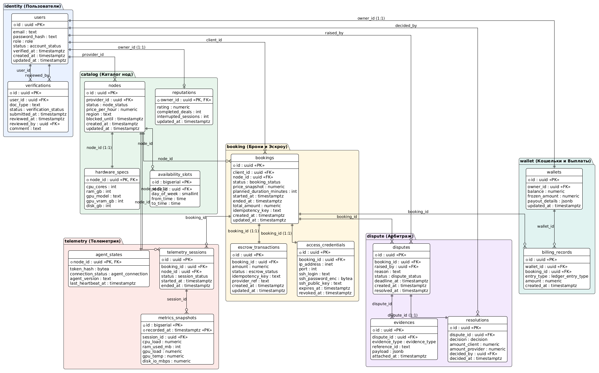
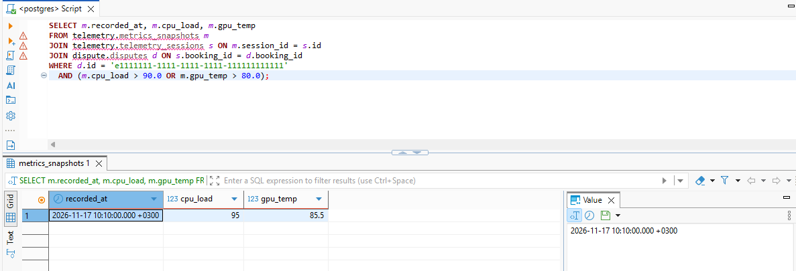
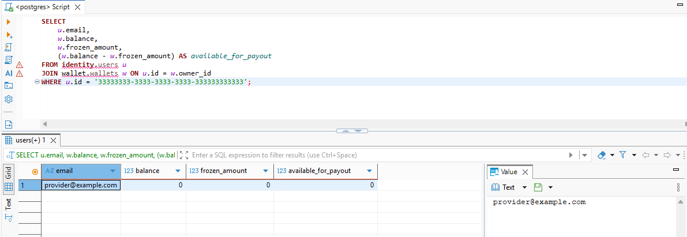
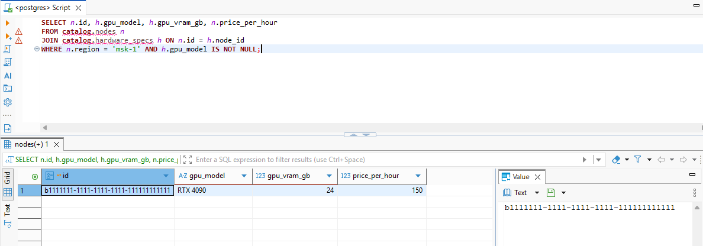
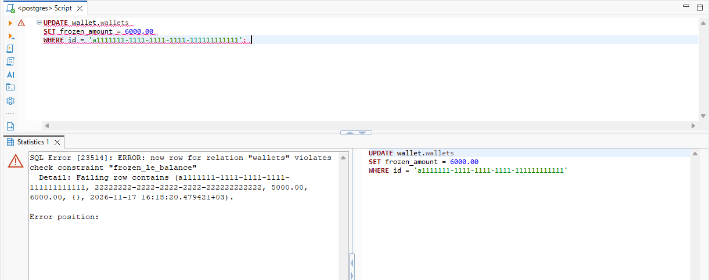
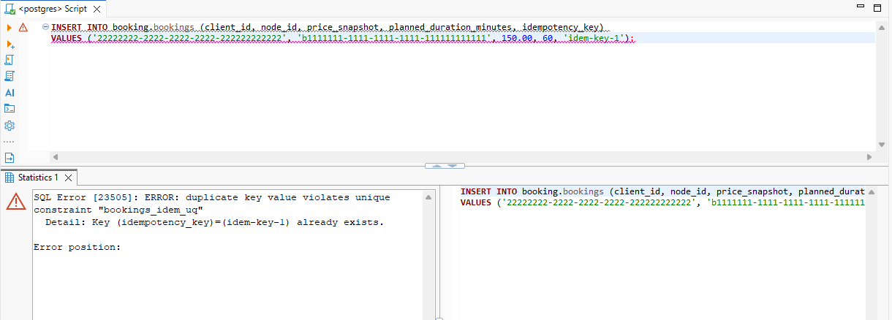
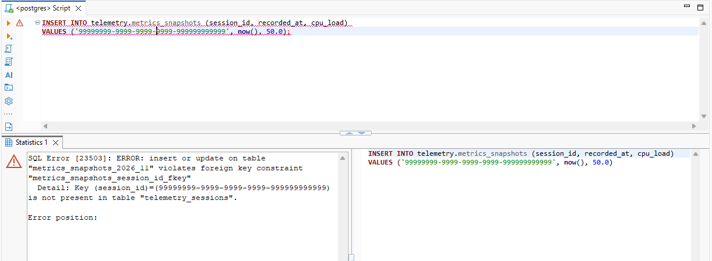
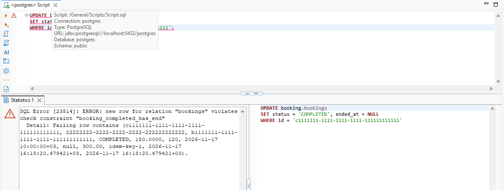

# 1. Решение по хранилищам
### 1.1. Сколько баз данных

Одна СУБД — PostgreSQL 16 — как system of record, внутри неё 7 схем по ограниченным контекстам. Плюс Redis как вспомогательное хранилище (кэш/эфемерное состояние), не являющееся источником истины. Итого два хранилища, из которых источник истины — одно.
| Хранилище | Роль | Что лежит | Источник истины? |
|:---|:---|:---|:---|
|PostgreSQL 16 |Транзакционное ядро	| Все 18 сущностей И4: пользователи, ноды, брони, эскроу, телеметрия, споры, кошельки, выплаты, outbox |	Да |
|Redis 7	| Кэш и эфемерное	| CatalogIndex (поисковый кэш каталога), TTL идемпотентных ключей «горячих» операций, чёрный список JWT, rate-limit |	Нет |

Схемы внутри PostgreSQL: identity, catalog, booking, telemetry, dispute, wallet, infra. Это ровно 7 подсистем из Итерации 4 (Notification не хранит данных — только шаблоны в коде/конфиге).

### 1.2. Почему одна БД, а не отдельная на каждый контекст
1. Эскроу требует атомарности. Сценарий UC‑1 «capture» — это одна транзакция: ```escrow.HOLD→CAPTURED``` + ```booking.ACTIVE→COMPLETED``` + запись в ```billing_records``` + запись в ```outbox```. Разнести это по разным БД значит получить распределённую транзакцию там, где достаточно ```BEGIN/COMMIT```. Для денег это недопустимый риск.
2. Команда 3–4 человека. Эксплуатация нескольких кластеров и CDC-конвейеров между ними — накладные расходы, не дающие бизнес-ценности на MVP. Это прямое следствие ADR‑001 (модульный монолит).
3. Логическая изоляция сохранена схемами. У каждой схемы свой владелец-роль, свой набор таблиц; чужие данные доступны приложению только через порты. Если домен придётся вынести в сервис, его схема отделяется от остальных без переписывания ядра.
4. Кросс-схемные FK осознанный компромисс. В монолите они дают ссылочную целостность. При выделении сервиса FK заменяются на проверку через порт + eventual consistency (компенсируется outbox-событиями). Это зафиксировано в ADR ниже.

### 1.3. SQL или NoSQL

Ядро SQL (PostgreSQL). Причины:

1. ACID для денег. ```EscrowTransaction```, ```Wallet```, ```BillingRecord```, ```PayoutRequest``` это строгий журнал. Нужны транзакции, блокировки строк, уникальные индексы для идемпотентности.

2. Ссылочная целостность. Бронь не может ссылаться на несуществующую ноду; доказательство — на несуществующий спор. В документной БД это проверяется только кодом.

3. Отчётные запросы. «Доход провайдера за 30 дней», «топ провайдеров», «свободные слоты на завтра» то JOIN'ы и агрегаты. Реляционная модель здесь естественна.

4. Схема стабильна и уже известна. 18 сущностей и 13 перечислений зафиксированы в И4; гибкость схемы NoSQL не нужна, а её отсутствие (нет FK, нет JOIN) минус.

Где NoSQL оправдан:

1. Redis — кэш каталога (поиск по фильтрам частая операция, каталог меняется редко), TTL идемпотентных ключей, сессии/JWT-чёрный список. Это не источник истины, потеря Redis не ломает данные.

2. Телеметрия — таблица metrics_snapshots в PostgreSQL с RANGE-партиционированием по времени. При росте > 10⁸ строк -> миграция на TimescaleDB (расширение PostgreSQL, тот же SQL, гипертаблицы) или вынос в ClickHouse (колоночное хранилище для аналитики). Для MVP это преждевременно: партиции + индексы покрывают нагрузку, а SQL-совместимость сохраняет простоту.

3. События — не Kafka, а transactional outbox в PostgreSQL (infra.outbox_events). Публикация события происходит в той же транзакции, что и изменение состояния, это гарантирует «ровно один раз» без брокера. При росте Debezium/CDC читает outbox и перекладывает в брокер.

### 1.4. Почему не NoSQL для ядра

| Аргумент за NoSQL | Почему не подходит для Cloudberries |
|:---|:---|
|Гибкая схема |	Схема уже известна и стабильна; миграции редки |
|Горизонтальное масштабирование |	На MVP нагрузка не требует шардирования; PG масштабируется вертикально + read-replicas |
|Документы «как есть» |	Бронь, эскроу, кошелёк это связанные сущности, а не изолированные документы |
| Eventual consistency	| Для денег недопустима; эскроу должен быть строго консистентным |

### 1.5. ADR‑006 (дополнение к ADR И4)

**ADR‑006. Одна PostgreSQL, схемы по контекстам, outbox вместо брокера.**<br>
**Контекст:** эскроу требует атомарности; команда мала; схема стабильна.<br>
**Решение:** один кластер PostgreSQL 16, 7 схем, кросс-схемные FK, infra.outbox_events для событий. Redis — только кэш.<br>
**Альтернативы:** БД-на-контекст (распределённые транзакции), Kafka (инфраструктурная сложность), MongoDB (нет FK/ACID между сущностями).<br>
**Последствия:** масштабирование целиком; вынос домена в сервис возможен без переписывания ядра; замена Redis/брокера — локальная правка адаптеров.

# 2. Отображение проектной модели И4 схема БД
### 2.1. Таблица соответствия

| Класс И4 | Таблица | Схема | Примечание |
|:---|:---|:---|:---|
|User	| users |	identity |	+ ```password_hash```, ```verified_at``` |
|Verification	| verifications |	identity |	CHECK на согласованность статуса и даты ревью |
|Node	| nodes |	catalog |	```status``` — enum, ```blocked_until``` |
|HardwareSpecs | hardware_specs |	catalog |	1:1 к ```nodes```, ```ON DELETE CASCADE``` |
|AvailabilitySchedule	| availability_slots |	catalog |	развёрнут в строки (день, from, to) |
|Reputation	| reputations |	catalog |	1:1 к ```users``` |
|Booking	| bookings |	booking |	```price_snapshot``` — снимок цены, ```idempotency_key UNIQUE``` |
|EscrowTransaction	| escrow_transactions |	booking |	1:1 к брони (UNIQUE ```booking_id```) |
|AccessCredentials	| access_credentials |	booking |	1:1 к брони, ```ssh_password_enc bytea``` |
|AgentState	| agent_states |	telemetry |	PK = ```node_id``` |
|TelemetrySession	| telemetry_sessions |	telemetry |	— |
|MetricsSnapshot	| metrics_snapshots |	telemetry |	RANGE-партиционирование по ```recorded_at``` |
|Dispute	| disputes |	dispute |	```deadline_at``` для окна 24 ч |
|Evidence	| evidences |	dispute |	```payload jsonb``` |
|Resolution	| resolutions |	dispute |	1:1 к спору (UNIQUE ```dispute_id```) |
|Wallet	| wallets |	wallet |	1:1 к ```users```, CHECK ```frozen <= balance``` |
|BillingRecord	| billing_records |	wallet |	журнал с ```entry_type```, ```idempotency_key``` UNIQUE |
|PayoutRequest	| payout_requests |	wallet |	```idempotency_key``` UNIQUE, ```bank_details_snapshot``` |
|EventBus	| outbox_events |	infra |	transactional outbox |

### 2.2. ER-диаграмма (упрощённая)



# 3. DDL (структура БД)
```
DROP SCHEMA IF EXISTS identity CASCADE;
DROP SCHEMA IF EXISTS catalog CASCADE;
DROP SCHEMA IF EXISTS booking CASCADE;
DROP SCHEMA IF EXISTS telemetry CASCADE;
DROP SCHEMA IF EXISTS dispute CASCADE;
DROP SCHEMA IF EXISTS wallet CASCADE;
DROP SCHEMA IF EXISTS infra CASCADE;

CREATE SCHEMA identity;
CREATE SCHEMA catalog;
CREATE SCHEMA booking;
CREATE SCHEMA telemetry;
CREATE SCHEMA dispute;
CREATE SCHEMA wallet;
CREATE SCHEMA infra;

CREATE TYPE identity.role                AS ENUM ('CLIENT','PROVIDER','ADMIN');
CREATE TYPE identity.account_status      AS ENUM ('PENDING','ACTIVE','BLOCKED');
CREATE TYPE identity.verification_status AS ENUM ('PENDING','APPROVED','REJECTED');

CREATE TYPE catalog.node_status AS ENUM ('INACTIVE','ONLINE','BUSY','MAINTENANCE','OFFLINE','DISPUTED');

CREATE TYPE booking.booking_status AS ENUM ('PENDING','ACTIVE','COMPLETED','CANCELLED','DISPUTED');
CREATE TYPE booking.escrow_status  AS ENUM ('HOLD','CAPTURED','FROZEN','REFUNDED','PARTIAL_REFUND');

CREATE TYPE telemetry.agent_connection AS ENUM ('CONNECTED','LOST');
CREATE TYPE telemetry.session_status   AS ENUM ('ACTIVE','FINISHED');

CREATE TYPE dispute.dispute_status AS ENUM ('OPEN','EVIDENCE_REQUESTED','SETTLEMENT','RESOLVED','CLOSED');
CREATE TYPE dispute.decision       AS ENUM ('REFUND_CLIENT','PAY_PROVIDER','SPLIT');
CREATE TYPE dispute.evidence_type  AS ENUM ('TELEMETRY','LOG','SCREENSHOT','MESSAGE');

CREATE TYPE wallet.payout_status     AS ENUM ('REQUESTED','PROCESSING','PAID','FAILED');
CREATE TYPE wallet.ledger_entry_type AS ENUM ('CREDIT','DEBIT','FEE','REFUND');

CREATE OR REPLACE FUNCTION infra.set_updated_at() RETURNS trigger
LANGUAGE plpgsql AS $$
BEGIN
  NEW.updated_at := now();
  RETURN NEW;
END $$;

CREATE TABLE identity.users (
  id            uuid PRIMARY KEY DEFAULT gen_random_uuid(),
  email         text NOT NULL,
  password_hash text NOT NULL,
  role          identity.role NOT NULL,
  status        identity.account_status NOT NULL DEFAULT 'PENDING',
  verified_at   timestamptz,
  created_at    timestamptz NOT NULL DEFAULT now(),
  updated_at    timestamptz NOT NULL DEFAULT now()
);
CREATE UNIQUE INDEX users_email_lower_uq ON identity.users (lower(email));
CREATE TRIGGER users_touch BEFORE UPDATE ON identity.users FOR EACH ROW EXECUTE FUNCTION infra.set_updated_at();

CREATE TABLE identity.verifications (
  id           uuid PRIMARY KEY DEFAULT gen_random_uuid(),
  user_id      uuid NOT NULL REFERENCES identity.users(id) ON DELETE CASCADE,
  doc_type     text NOT NULL,
  status       identity.verification_status NOT NULL DEFAULT 'PENDING',
  submitted_at timestamptz NOT NULL DEFAULT now(),
  reviewed_at  timestamptz,
  reviewed_by  uuid REFERENCES identity.users(id),
  comment      text,
  CONSTRAINT reviewed_consistency CHECK (
    (status = 'PENDING' AND reviewed_at IS NULL) OR
    (status <> 'PENDING' AND reviewed_at IS NOT NULL)
  )
);
CREATE INDEX verifications_user_idx ON identity.verifications(user_id);

CREATE TABLE catalog.nodes (
  id             uuid PRIMARY KEY DEFAULT gen_random_uuid(),
  provider_id    uuid NOT NULL REFERENCES identity.users(id),
  status         catalog.node_status NOT NULL DEFAULT 'INACTIVE',
  price_per_hour numeric(12,4) NOT NULL,
  region         text NOT NULL,
  blocked_until  timestamptz,
  created_at     timestamptz NOT NULL DEFAULT now(),
  updated_at     timestamptz NOT NULL DEFAULT now(),
  CONSTRAINT check_price_positive CHECK (price_per_hour >= 0) -- ВОЗВРАЩЕНО ОГРАНИЧЕНИЕ
);
CREATE INDEX nodes_status_region_idx ON catalog.nodes(status, region);
CREATE TRIGGER nodes_touch BEFORE UPDATE ON catalog.nodes FOR EACH ROW EXECUTE FUNCTION infra.set_updated_at();

CREATE TABLE catalog.hardware_specs (
  node_id     uuid PRIMARY KEY REFERENCES catalog.nodes(id) ON DELETE CASCADE,
  cpu_cores   int NOT NULL,
  ram_gb      int NOT NULL,
  gpu_model   text,
  gpu_vram_gb int,
  disk_gb     int NOT NULL,
  CONSTRAINT check_hardware_positive CHECK (cpu_cores > 0 AND ram_gb > 0 AND disk_gb > 0 AND (gpu_vram_gb IS NULL OR gpu_vram_gb > 0))
);

CREATE TABLE catalog.availability_slots (
  id          bigserial PRIMARY KEY,
  node_id     uuid NOT NULL REFERENCES catalog.nodes(id) ON DELETE CASCADE,
  day_of_week smallint NOT NULL CHECK (day_of_week BETWEEN 0 AND 6),
  from_time   time NOT NULL,
  to_time     time NOT NULL,
  CONSTRAINT slot_order CHECK (from_time < to_time)
);

CREATE TABLE catalog.reputations (
  owner_id             uuid PRIMARY KEY REFERENCES identity.users(id) ON DELETE CASCADE,
  rating               numeric(3,2) NOT NULL DEFAULT 0,
  completed_deals      int NOT NULL DEFAULT 0,
  interrupted_sessions int NOT NULL DEFAULT 0,
  updated_at           timestamptz NOT NULL DEFAULT now(),
  CONSTRAINT check_rating CHECK (rating BETWEEN 0 AND 5),
  CONSTRAINT check_counts_positive CHECK (completed_deals >= 0 AND interrupted_sessions >= 0)
);
CREATE TRIGGER reputations_touch BEFORE UPDATE ON catalog.reputations FOR EACH ROW EXECUTE FUNCTION infra.set_updated_at();

CREATE TABLE booking.bookings (
  id                       uuid PRIMARY KEY DEFAULT gen_random_uuid(),
  client_id                uuid NOT NULL REFERENCES identity.users(id),
  node_id                  uuid NOT NULL REFERENCES catalog.nodes(id),
  status                   booking.booking_status NOT NULL DEFAULT 'PENDING',
  price_snapshot           numeric(12,4) NOT NULL,
  planned_duration_minutes int NOT NULL,
  started_at               timestamptz,
  ended_at                 timestamptz,
  total_amount             numeric(12,2) NOT NULL DEFAULT 0,
  idempotency_key          text NOT NULL,
  created_at               timestamptz NOT NULL DEFAULT now(),
  updated_at               timestamptz NOT NULL DEFAULT now(),
  CONSTRAINT booking_completed_has_end CHECK (status <> 'COMPLETED' OR ended_at IS NOT NULL), -- ВОЗВРАЩЕНО ОГРАНИЧЕНИЕ
  CONSTRAINT check_booking_math CHECK (price_snapshot >= 0 AND total_amount >= 0 AND planned_duration_minutes > 0)
);
CREATE UNIQUE INDEX bookings_idem_uq ON booking.bookings(idempotency_key);
CREATE TRIGGER bookings_touch BEFORE UPDATE ON booking.bookings FOR EACH ROW EXECUTE FUNCTION infra.set_updated_at();

CREATE TABLE booking.escrow_transactions (
  id              uuid PRIMARY KEY DEFAULT gen_random_uuid(),
  booking_id      uuid NOT NULL REFERENCES booking.bookings(id),
  amount          numeric(12,2) NOT NULL,
  status          booking.escrow_status NOT NULL DEFAULT 'HOLD',
  idempotency_key text NOT NULL,
  provider_ref    text,
  created_at      timestamptz NOT NULL DEFAULT now(),
  updated_at      timestamptz NOT NULL DEFAULT now(),
  CONSTRAINT check_escrow_amount CHECK (amount >= 0)
);
CREATE UNIQUE INDEX escrow_idem_uq ON booking.escrow_transactions(idempotency_key);
CREATE UNIQUE INDEX escrow_one_per_booking_uq ON booking.escrow_transactions(booking_id);

CREATE TABLE booking.access_credentials (
  id               uuid PRIMARY KEY DEFAULT gen_random_uuid(),
  booking_id       uuid NOT NULL REFERENCES booking.bookings(id) ON DELETE CASCADE,
  ip_address       inet NOT NULL,
  port             int NOT NULL CHECK (port BETWEEN 1 AND 65535),
  ssh_login        text NOT NULL,
  ssh_password_enc bytea,
  ssh_public_key   text,
  expires_at       timestamptz NOT NULL,
  revoked_at       timestamptz
);

CREATE TABLE telemetry.agent_states (
  node_id           uuid PRIMARY KEY REFERENCES catalog.nodes(id) ON DELETE CASCADE,
  token_hash        bytea NOT NULL,
  connection_status telemetry.agent_connection NOT NULL DEFAULT 'LOST',
  agent_version     text,
  last_heartbeat_at timestamptz
);

CREATE TABLE telemetry.telemetry_sessions (
  id         uuid PRIMARY KEY DEFAULT gen_random_uuid(),
  booking_id uuid NOT NULL REFERENCES booking.bookings(id),
  node_id    uuid NOT NULL REFERENCES catalog.nodes(id),
  status     telemetry.session_status NOT NULL DEFAULT 'ACTIVE',
  started_at timestamptz NOT NULL DEFAULT now(),
  ended_at   timestamptz
);

CREATE TABLE telemetry.metrics_snapshots (
  id           bigserial,
  session_id   uuid NOT NULL REFERENCES telemetry.telemetry_sessions(id) ON DELETE CASCADE,
  recorded_at  timestamptz NOT NULL,
  cpu_load     numeric(5,2),
  ram_used_mb  int,
  gpu_load     numeric(5,2),
  gpu_temp     numeric(5,2),
  disk_io_mbps numeric(10,2),
  PRIMARY KEY (id, recorded_at),
  CONSTRAINT check_cpu_load CHECK (cpu_load IS NULL OR cpu_load BETWEEN 0 AND 100),
  CONSTRAINT check_ram CHECK (ram_used_mb IS NULL OR ram_used_mb >= 0)
) PARTITION BY RANGE (recorded_at);

CREATE TABLE telemetry.metrics_snapshots_2026_11 PARTITION OF telemetry.metrics_snapshots FOR VALUES FROM ('2026-11-01') TO ('2026-12-01');
CREATE TABLE telemetry.metrics_snapshots_2026_12 PARTITION OF telemetry.metrics_snapshots FOR VALUES FROM ('2026-12-01') TO ('2027-01-01');
CREATE TABLE telemetry.metrics_snapshots_default PARTITION OF telemetry.metrics_snapshots DEFAULT;

CREATE TABLE dispute.disputes (
  id          uuid PRIMARY KEY DEFAULT gen_random_uuid(),
  booking_id  uuid NOT NULL REFERENCES booking.bookings(id),
  raised_by   uuid NOT NULL REFERENCES identity.users(id),
  reason      text NOT NULL,
  status      dispute.dispute_status NOT NULL DEFAULT 'OPEN',
  deadline_at timestamptz NOT NULL,
  created_at  timestamptz NOT NULL DEFAULT now(),
  resolved_at timestamptz
);

CREATE TABLE dispute.evidences (
  id            uuid PRIMARY KEY DEFAULT gen_random_uuid(),
  dispute_id    uuid NOT NULL REFERENCES dispute.disputes(id) ON DELETE CASCADE,
  evidence_type dispute.evidence_type NOT NULL,
  reference_id  text,
  payload       jsonb NOT NULL DEFAULT '{}'::jsonb,
  attached_at   timestamptz NOT NULL DEFAULT now()
);

CREATE TABLE dispute.resolutions (
  id              uuid PRIMARY KEY DEFAULT gen_random_uuid(),
  dispute_id      uuid NOT NULL UNIQUE REFERENCES dispute.disputes(id),
  decision        dispute.decision NOT NULL,
  amount_client   numeric(12,2) NOT NULL DEFAULT 0,
  amount_provider numeric(12,2) NOT NULL DEFAULT 0,
  decided_by      uuid NOT NULL REFERENCES identity.users(id),
  decided_at      timestamptz NOT NULL DEFAULT now(),
  CONSTRAINT check_resolution_amounts CHECK (amount_client >= 0 AND amount_provider >= 0)
);

CREATE TABLE wallet.wallets (
  id             uuid PRIMARY KEY DEFAULT gen_random_uuid(),
  owner_id       uuid NOT NULL UNIQUE REFERENCES identity.users(id),
  balance        numeric(14,2) NOT NULL DEFAULT 0,
  frozen_amount  numeric(14,2) NOT NULL DEFAULT 0,
  payout_details jsonb NOT NULL DEFAULT '{}'::jsonb,
  updated_at     timestamptz NOT NULL DEFAULT now(),
  CONSTRAINT check_balance_positive CHECK (balance >= 0),
  CONSTRAINT check_frozen_positive CHECK (frozen_amount >= 0),
  CONSTRAINT frozen_le_balance CHECK (frozen_amount <= balance) -- ВОЗВРАЩЕНО ОГРАНИЧЕНИЕ
);
CREATE TRIGGER wallets_touch BEFORE UPDATE ON wallet.wallets FOR EACH ROW EXECUTE FUNCTION infra.set_updated_at();

CREATE TABLE wallet.billing_records (
  id              uuid PRIMARY KEY DEFAULT gen_random_uuid(),
  wallet_id       uuid NOT NULL REFERENCES wallet.wallets(id),
  booking_id      uuid REFERENCES booking.bookings(id),
  entry_type      wallet.ledger_entry_type NOT NULL,
  amount          numeric(12,2) NOT NULL,
  created_at      timestamptz NOT NULL DEFAULT now()
);

CREATE TABLE wallet.payout_requests (
  id              uuid PRIMARY KEY DEFAULT gen_random_uuid(),
  provider_id     uuid NOT NULL REFERENCES identity.users(id),
  amount          numeric(12,2) NOT NULL CHECK (amount > 0),
  status          wallet.payout_status NOT NULL DEFAULT 'REQUESTED',
  idempotency_key uuid NOT NULL UNIQUE,
  created_at      timestamptz NOT NULL DEFAULT now(),
  processed_at    timestamptz
);

CREATE TABLE infra.outbox_events (
  id             bigserial PRIMARY KEY,
  aggregate_type text NOT NULL,
  aggregate_id   uuid NOT NULL,
  event_type     text NOT NULL,
  payload        jsonb NOT NULL,
  created_at     timestamptz NOT NULL DEFAULT now(),
  processed_at   timestamptz
);
```

### 3.1 Наполнение данными
```
-- 1. Пользователи
INSERT INTO identity.users (id, email, password_hash, role, status) VALUES
('11111111-1111-1111-1111-111111111111', 'admin@cloudberries.ru', 'hash', 'ADMIN', 'ACTIVE'),
('22222222-2222-2222-2222-222222222222', 'client@example.com', 'hash', 'CLIENT', 'ACTIVE'),
('33333333-3333-3333-3333-333333333333', 'provider@example.com', 'hash', 'PROVIDER', 'ACTIVE');

-- 2. Кошельки и репутация
INSERT INTO wallet.wallets (id, owner_id, balance, frozen_amount) VALUES
('a1111111-1111-1111-1111-111111111111', '22222222-2222-2222-2222-222222222222', 5000.00, 0),
('a2222222-2222-2222-2222-222222222222', '33333333-3333-3333-3333-333333333333', 0.00, 0);

INSERT INTO catalog.reputations (owner_id, rating, completed_deals) VALUES
('33333333-3333-3333-3333-333333333333', 4.8, 10);

-- 3. Нода провайдера и её характеристики
INSERT INTO catalog.nodes (id, provider_id, status, price_per_hour, region) VALUES
('b1111111-1111-1111-1111-111111111111', '33333333-3333-3333-3333-333333333333', 'BUSY', 150.00, 'msk-1');

INSERT INTO catalog.hardware_specs (node_id, cpu_cores, ram_gb, gpu_model, gpu_vram_gb, disk_gb) VALUES
('b1111111-1111-1111-1111-111111111111', 16, 64, 'RTX 4090', 24, 1000);

INSERT INTO catalog.availability_slots (node_id, day_of_week, from_time, to_time) VALUES
('b1111111-1111-1111-1111-111111111111', 1, '00:00', '23:59');

-- 4. Агент (Heartbeat)
INSERT INTO telemetry.agent_states (node_id, token_hash, connection_status, agent_version, last_heartbeat_at) VALUES
('b1111111-1111-1111-1111-111111111111', '\x1234', 'CONNECTED', 'v1.0.2', now() - interval '2 minutes');

-- 5. Бронь и Эскроу (Активная аренда)
INSERT INTO booking.bookings (id, client_id, node_id, status, price_snapshot, planned_duration_minutes, started_at, total_amount, idempotency_key) VALUES
('c1111111-1111-1111-1111-111111111111', '22222222-2222-2222-2222-222222222222', 'b1111111-1111-1111-1111-111111111111', 'ACTIVE', 150.00, 120, '2026-11-17 10:00:00+03', 300.00, 'idem-key-1');

INSERT INTO booking.escrow_transactions (booking_id, amount, status, idempotency_key, provider_ref) VALUES
('c1111111-1111-1111-1111-111111111111', 300.00, 'HOLD', 'idem-key-1', 'pay_abc_123');

INSERT INTO booking.access_credentials (booking_id, ip_address, port, ssh_login, ssh_public_key, expires_at) VALUES
('c1111111-1111-1111-1111-111111111111', '10.0.0.1', 22, 'client', 'ssh-rsa AAA...', '2026-11-17 12:00:00+03');

-- 6. Телеметрия сессии
INSERT INTO telemetry.telemetry_sessions (id, booking_id, node_id, status, started_at) VALUES
('d1111111-1111-1111-1111-111111111111', 'c1111111-1111-1111-1111-111111111111', 'b1111111-1111-1111-1111-111111111111', 'ACTIVE', '2026-11-17 10:00:00+03');

-- Метрики (партиция 2026_11 сработает автоматически)
INSERT INTO telemetry.metrics_snapshots (session_id, recorded_at, cpu_load, ram_used_mb, gpu_temp, disk_io_mbps) VALUES
('d1111111-1111-1111-1111-111111111111', '2026-11-17 10:05:00+03', 45.5, 16000, 65.0, 120.5),
('d1111111-1111-1111-1111-111111111111', '2026-11-17 10:10:00+03', 95.0, 32000, 85.5, 500.0); -- Перегрев!

-- 7. Спор и Доказательство (Клиент жалуется на перегрев)
INSERT INTO dispute.disputes (id, booking_id, raised_by, reason, status, deadline_at) VALUES
('e1111111-1111-1111-1111-111111111111', 'c1111111-1111-1111-1111-111111111111', '22222222-2222-2222-2222-222222222222', 'GPU перегревался', 'OPEN', '2026-11-18 10:00:00+03');

INSERT INTO dispute.evidences (dispute_id, evidence_type, reference_id) VALUES
('e1111111-1111-1111-1111-111111111111', 'TELEMETRY', 'd1111111-1111-1111-1111-111111111111');

-- 8. Финансовая история (Провайдеру начислено за прошлую сессию)
-- Историческое начисление относится к отдельной завершённой аренде, а не к
-- текущей ACTIVE-брони c111...; это сохраняет инвариант ITER6:
-- провайдер получает деньги только после завершения брони.
INSERT INTO booking.bookings
  (id, client_id, node_id, status, price_snapshot, planned_duration_minutes,
   started_at, ended_at, total_amount, idempotency_key)
VALUES
  ('c2222222-2222-2222-2222-222222222222',
   '22222222-2222-2222-2222-222222222222',
   'b1111111-1111-1111-1111-111111111111',
   'COMPLETED', 150.00, 120, '2026-11-16 10:00:00+03',
   '2026-11-16 12:00:00+03', 300.00, 'idem-key-history-1');

INSERT INTO wallet.billing_records (wallet_id, booking_id, entry_type, amount) VALUES
('a2222222-2222-2222-2222-222222222222', 'c2222222-2222-2222-2222-222222222222', 'CREDIT', 285.00);
```


# 4. Тестовые проверки

### 4.1 Показываем работу системы запросами, которые соответствуют Use Case'ам.

**Тест 1: Сбор доказательств для Арбитража (UC-3)**
Админ ищет аномалии (нагрузка > 90% или температура > 80) по конкретному спору.

```
SELECT m.recorded_at, m.cpu_load, m.gpu_temp, m.ram_used_mb
FROM telemetry.metrics_snapshots m
JOIN telemetry.telemetry_sessions s ON m.session_id = s.id
JOIN dispute.disputes d ON s.booking_id = d.booking_id
WHERE d.id = 'e1111111-1111-1111-1111-111111111111'
  AND (m.cpu_load > 90.0 OR m.gpu_temp > 80.0)
ORDER BY m.recorded_at;
```
(Результат: выведет запись от 10:10, доказывающую правоту клиента).


**Тест 2: Дашборд Провайдера (UC-4)**
Провайдер смотрит свой баланс и видит, что деньги заморожены, а также историю начислений.

```
SELECT 
    u.email, 
    w.balance, 
    w.frozen_amount,
    (w.balance - w.frozen_amount) AS available_for_payout,
    br.entry_type, 
    br.amount
FROM identity.users u
JOIN wallet.wallets w ON u.id = w.owner_id
LEFT JOIN wallet.billing_records br ON w.id = br.wallet_id
WHERE u.id = '33333333-3333-3333-3333-333333333333';
```


**Тест 3: Поиск доступных мощностей (UC-1)**
Клиент ищет ноды с GPU в регионе msk-1, которые сейчас онлайн.

```
SELECT n.id, h.gpu_model, h.gpu_vram_gb, n.price_per_hour
FROM catalog.nodes n
JOIN catalog.hardware_specs h ON n.id = h.node_id
WHERE n.region = 'msk-1' 
  AND n.status = 'ONLINE' 
  AND h.gpu_model IS NOT NULL;
```


### 4.2 Отрицательные тесты (Что отклонила база)

Это самая важная часть доказать, что ограничения работают. При выполнении этих команд база должна выдать ошибку.

**Тест А: Попытка заморозить больше денег, чем есть на балансе**
(Сработает CHECK frozen_le_balance)

```
UPDATE wallet.wallets 
SET frozen_amount = 6000.00 
WHERE id = 'a1111111-1111-1111-1111-111111111111';
```
-- Ожидаемая ошибка: new row for relation "wallets" violates check constraint "frozen_le_balance" (SQLSTATE 23514)


**Тест Б: Повторная отправка той же брони (Дубликат идемпотентности)**
(Сработает UNIQUE индекс bookings_idem_uq)

```
INSERT INTO booking.bookings (client_id, node_id, price_snapshot, planned_duration_minutes, idempotency_key) 
VALUES ('22222222-2222-2222-2222-222222222222', 'b1111111-1111-1111-1111-111111111111', 150.00, 60, 'idem-key-1');
```
-- Ожидаемая ошибка: duplicate key value violates unique constraint "bookings_idem_uq" (SQLSTATE 23505)


**Тест В: Привязка телеметрии к несуществующей сессии**
(Сработает внешний ключ)

```
INSERT INTO telemetry.metrics_snapshots (session_id, recorded_at, cpu_load) 
VALUES ('99999999-9999-9999-9999-999999999999', now(), 50.0);
```
-- Ожидаемая ошибка: insert or update on table "metrics_snapshots" violates foreign key constraint (SQLSTATE 23503)


**Тест Г: Завершение брони без указания времени окончания**
(Сработает CHECK booking_completed_has_end)

```
UPDATE booking.bookings 
SET status = 'COMPLETED', ended_at = NULL 
WHERE id = 'c1111111-1111-1111-1111-111111111111';
```
-- Ожидаемая ошибка: new row for relation "bookings" violates check constraint "booking_completed_has_end" (SQLSTATE 23514)

