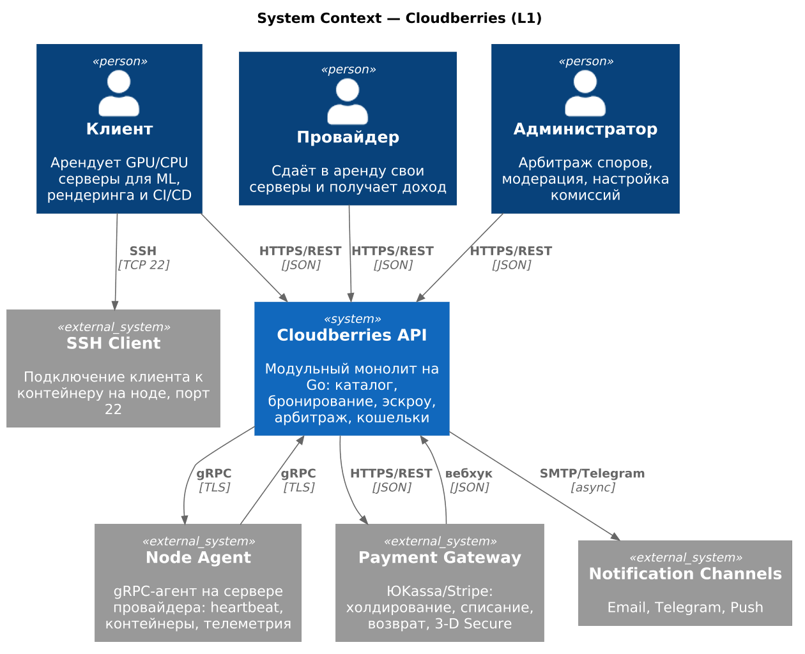
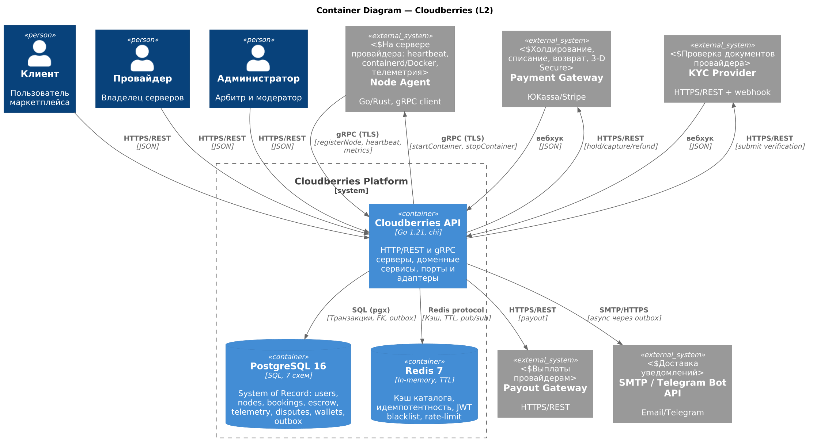
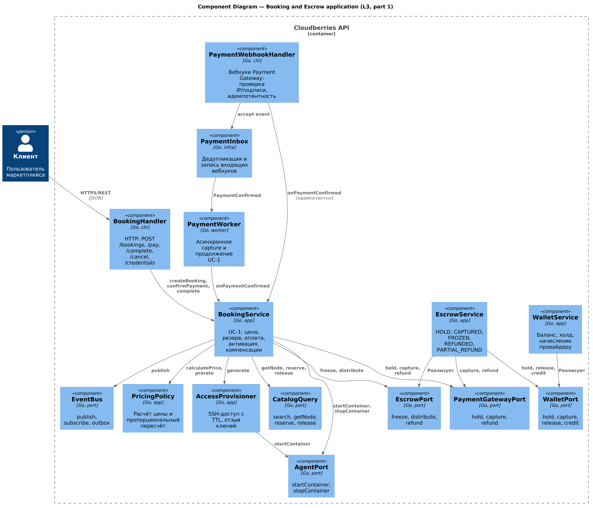
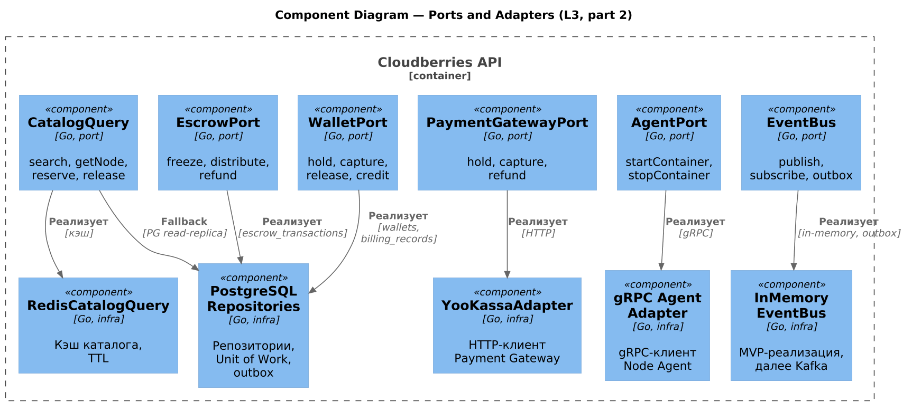
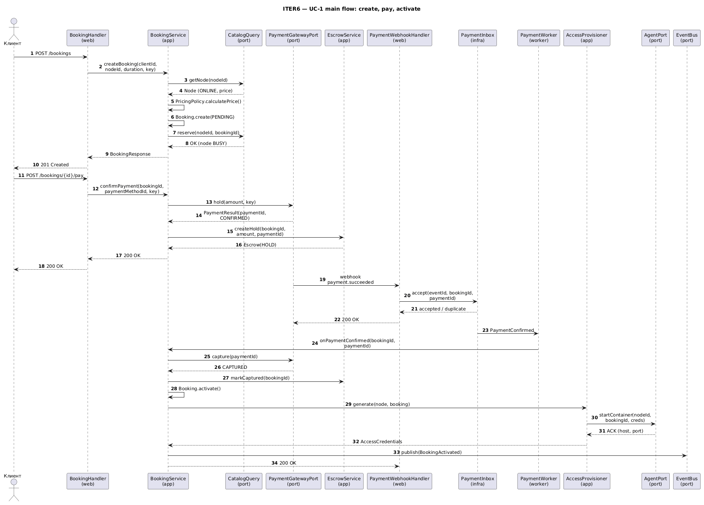
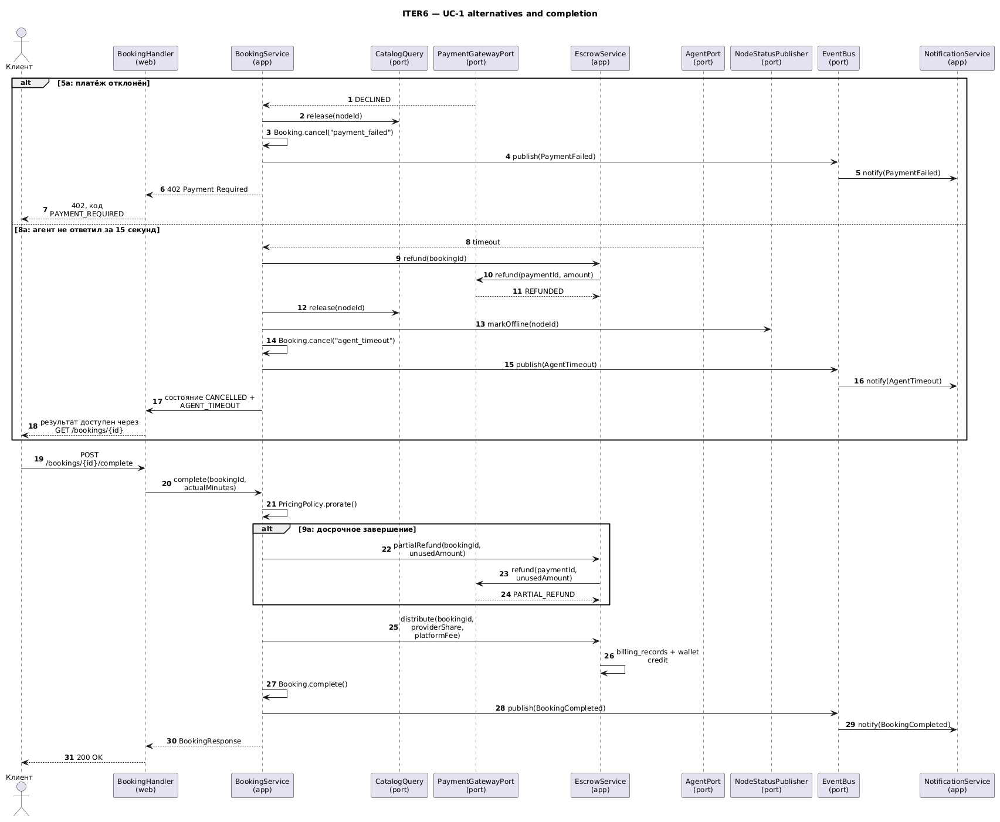

# Часть 1. Архитектура

## 1.1. Архитектурно значимые требования (ASR) и сценарии качества по ISO/IEC 25010

| # | ASR (бизнес) | Подхарактеристика ISO/IEC 25010 | Сценарий качества (источник / стимул / окружение / артефакт / реакция / мера) |
|---|---|---|---|
| **ASR-1** | **Надёжность эскроу: деньги не теряются при сбоях** | **Reliability → Fault tolerance / Recoverability** | **Источник:** Payment Gateway или Node Agent.<br>**Стимул:** таймаут шлюза либо отказ агента после HOLD.<br>**Окружение:** runtime, активная бронь, средства в HOLD.<br>**Артефакт:** `EscrowTransaction`, `Booking`, `Wallet`.<br>**Реакция:** компенсация `EscrowService.refund()`, `Booking.cancel()`, `CatalogQuery.release()`, затем событие `PaymentFailed` / `AgentTimeout` в outbox.<br>**Мера:** RTO ≤ 30 с, RPO = 0, 100% денежных операций идемпотентны по `Idempotency-Key`. |
| **ASR-2** | **Арбитраж решает спор за ≤ 24 ч с доказательствами** | **Functional Suitability → Functional correctness / Functional completeness** | **Источник:** администратор-арбитр.<br>**Стимул:** открыт спор, нужна телеметрия за период аренды.<br>**Окружение:** `Dispute` в статусе `OPEN`, `TelemetrySession` завершена.<br>**Артефакт:** `Evidence` типа `TELEMETRY`, `MetricsSnapshot[]`.<br>**Реакция:** `EvidenceService.collectEvidence()` → `TelemetryQuery.metricsFor(nodeId, from, to)` → доказательства прикреплены к спору.<br>**Мера:** 100% минутных снэпшотов CPU/GPU/RAM/disk за период; время сбора ≤ 5 с — ограничение Performance Efficiency, а не функциональной полноты. |
| **ASR-3** | **Каталог отдаёт доступные ноды за ≤ 200 мс под нагрузкой** | **Performance Efficiency → Time behaviour** | **Источник:** клиент (UI/API).<br>**Стимул:** `GET /api/v1/nodes?gpu=true&region=msk-1`.<br>**Окружение:** 10k+ нод, кэш `CatalogIndex` валиден.<br>**Артефакт:** `CatalogService.searchNodes()` → `CatalogQuery` → Redis `ZRANGEBYSCORE` / `HGETALL`.<br>**Реакция:** отфильтрованный список (id, gpu_model, price, region).<br>**Мера:** p95 ≤ 200 мс, p99 ≤ 500 мс при 1000 RPS; при промахе кэша fallback в PostgreSQL ≤ 1 с. |
| **ASR-4** | **Node Agent переподключается и синхронизирует состояние за ≤ 1 мин** | **Reliability → Recoverability** | **Источник:** Node Agent на сервере провайдера.<br>**Стимул:** разрыв gRPC-соединения.<br>**Окружение:** `AgentState.connection_status = LOST`, `last_heartbeat_at > 60 с`.<br>**Артефакт:** `AgentState`, `Node.status` через `NodeStatusPublisher`.<br>**Реакция:** агент переподключается, `startContainer` / `sendHeartbeat`, `HeartbeatMonitor.sweep()` возвращает `Node: OFFLINE → ONLINE`.<br>**Мера:** MTTR ≤ 60 с, активные контейнеры не убиваются при переподключении. |
| **ASR-5** | **Неавторизованный доступ к SSH ноды невозможен** | **Security → Confidentiality / Authenticity** | **Источник:** злоумышленник (перехват credentials или подбор JWT).<br>**Стимул:** попытка SSH с истёкшим/поддельным ключом.<br>**Окружение:** `AccessCredentials.expires_at < now()` или `revoked_at IS NOT NULL`.<br>**Артефакт:** `AccessCredentials`, `AgentPort.startContainer()`.<br>**Реакция:** `AccessProvisioner` выдаёт TTL-ключи, агент проверяет `expires_at` и `revoked_at` при каждом запуске.<br>**Мера:** TTL ключа ≤ длительность брони + 5 мин, 0 успешных атак при пентесте. |
| **ASR-6** | **Горизонтальное масштабирование статики/кэша без переписывания ядра** | **Maintainability → Modularity / Modifiability** | **Источник:** DevOps и бизнес (рост трафика ×10).<br>**Стимул:** нагрузка на каталог и телеметрию превышает single-node.<br>**Окружение:** модульный монолит, `internal/domain/` не зависит от `internal/infra/`.<br>**Артефакт:** порты `CatalogQuery`, `TelemetryQuery`, `EventBus`, адаптеры Redis / TimescaleDB / Kafka.<br>**Реакция:** замена адаптеров `RedisCatalogQuery → PostgresCatalogQuery` (read-replica), `InMemoryEventBus → KafkaEventBus` без изменений в `BookingService`, `EscrowService`.<br>**Мера:** выделение домена в сервис ≤ 1 неделя, 0 breaking changes в доменном слое. |
| **ASR-7** | **Любая финансовая операция прослеживается end-to-end** | **Security → Accountability / Non-repudiation** | **Источник:** аудитор / compliance.<br>**Стимул:** запрос «покажи путь рубля от клиента к провайдеру за бронирование #123».<br>**Окружение:** `outbox_events`, `billing_records`, `escrow_transactions`, `wallets`.<br>**Артефакт:** корреляция по `booking_id` / `idempotency_key` через все таблицы.<br>**Реакция:** SQL JOIN по цепочке `booking → escrow → wallet → billing → payout`.<br>**Мера:** 100% покрытие денежных потоков, отчёт ≤ 1 с, append-only журнал с запретом UPDATE/DELETE. |

## 1.2. Сравнение архитектурных стилей и выбор

Критерии взвешены по влиянию на бизнес и ограничения команды. Оценка — 1–5,
итог — взвешенная сумма.

| Критерий (вес) | Модульный монолит | Микросервисы | Event-Driven |
|---|---:|---:|---:|
| Атомарность эскроу, ASR-1 (25%) | **5** — `BEGIN/COMMIT` в одной БД | 2 — саги и распределённые транзакции | 2 — eventual consistency недопустима для денег |
| Команда 3–4 человека и время до MVP (20%) | **5** — один репозиторий и деплой | 2 — 7+ сервисов, CI/CD, контракты | 3 — брокер и схемы событий |
| Производительность каталога, ASR-3 (15%) | 4 — Redis за портом `CatalogQuery` | 4 — независимое масштабирование | **5** — CQRS-проекции естественны |
| Восстановление Node Agent, ASR-4 (10%) | **4** — gRPC внутри процесса | 3 — service discovery и retry | 3 — задержка через брокер |
| Выделение домена в сервис, ASR-6 (10%) | **5** — схемы БД + порты | **5** — уже выделены | **5** — уже развязаны |
| Аудит и прослеживаемость, ASR-7 (10%) | **5** — JOIN по `booking_id` | 2 — распределённый трейсинг | 3 — event store и проекции |
| Инфраструктурная сложность (10%) | **5** — 1 PG, 1 Redis, 1 бинарник | 2 — K8s, mesh, secrets | 2 — Kafka/NATS, schema registry, DLQ |
| **Взвешенный итог** | **4,75** | **2,70** | **3,15** |

**Минусы выбранного варианта (чтобы таблица не была пристрастной):**

- единая точка отказа: падение процесса останавливает весь API;
- масштабирование только целиком (вертикально + read-replicas);
- деплой связан: изменение каталога требует пересборки общего бинарника;
- при росте команды границы модулей придётся защищать правилами импортов и ревью.

**Выбор: слоистый модульный монолит (Layered Modular Monolith).**

Обоснование:

1. Эскроу требует строгой ACID-транзакции «списание + запись эскроу + смена
   статуса брони» (ADR-001).
2. Команда мала, оверхед микросервисов не окупается на MVP.
3. Границы доменов уже изолированы портами и схемами БД — выделение в сервис
   возможно позже без переписывания ядра (ASR-6).
4. События используются только для обратных уведомлений и аудита (ADR-007),
   а не как основной способ согласования денежных операций.


## 1.3. C4-диаграммы

### 1.3.1. System Context (L1)



*Рис. 1. Контекст: клиент, провайдер, администратор, платформа и внешние системы.
Node Agent вынесен за границу платформы — это ПО на сервере провайдера, а не
контейнер Cloudberries. Вебхук Payment Gateway показан отдельной стрелкой
`pgw → api`.*

### 1.3.2. Containers (L2)



*Рис. 2. Контейнеры: API-процесс, PostgreSQL, Redis и внешние системы. WebSocket
из ранней версии убран: уведомления идут через email/Telegram, а не через
постоянное соединение. PostgreSQL — System of Record, Redis — только кэш,
идемпотентность, blacklist и rate-limit.*

### 1.3.3. Components (L3)

L3 разделён на две части, чтобы диаграмма оставалась читаемой: прикладные
компоненты и порты/адаптеры. Полный перечень компонентов — в таблице 1.3.4.



*Рис. 3. Прикладные компоненты UC-1: `BookingHandler`, `PaymentWebhookHandler`,
`BookingService`, `EscrowService`, `PricingPolicy`, `AccessProvisioner`,
`WalletService` и исходящие порты. Стрелки «Реализует» идут от реализации к
порту, «Зависит» — от потребителя к порту.*



*Рис. 4. Порты и адаптеры: Redis/PG для каталога, PostgreSQL для кошелька и
эскроу, YooKassa, gRPC Agent, in-memory EventBus. `RedisCatalogQuery` реализует
только `search/getNode`; `reserve/release` выполняются в PostgreSQL, чтобы
резерв ноды и создание брони были атомарными.*

### 1.3.4. Реестр компонентов

| Компонент | Слой | Ответственность | Интерфейсы |
|---|---|---|---|
| `BookingHandler` | web | HTTP-операции брони, оплаты, завершения, credentials | `BookingService` |
| `CatalogHandler` | web | Публичный поиск и детали ноды | `CatalogService` |
| `NodeHandler` | web | Онбординг и настройка нод провайдера | `NodeService` |
| `DisputeHandler` | web | Открытие и просмотр спора | `DisputeService` |
| `ArbitrationHandler` | web | Очередь и решение споров (ADMIN) | `DisputeService` |
| `WalletHandler` | web | Баланс, история, выплаты | `WalletService`, `PayoutService` |
| `AuthHandler` | web | Регистрация, вход, refresh, KYC | `AuthService` |
| `PaymentWebhookHandler` | web | Приём вебхуков, проверка IP/подписи, запись в inbox и идемпотентность | inbox/outbox → `BookingService.onPaymentConfirmed` |
| `PaymentInbox` | infra | Дедупликация входящих платёжных вебхуков по `provider_event_id` | `infra.inbox_events` |
| `PaymentWorker` | app/worker | Асинхронный capture, активация и компенсация UC-1 | `BookingService`, `EscrowService`, `AgentPort` |
| `AuthMiddleware` | web | JWT, RBAC, `tv`/`ver`, blacklist | `IdentityQuery`, Redis |
| `RateLimiter` | web | Лимиты по IP/пользователю/эндпоинту | Redis |
| `BookingService` | app | UC-1: цена, резерв, оплата, активация, компенсации | `CatalogQuery`, `PaymentGatewayPort`, `AgentPort`, `EscrowPort`, `EventBus` |
| `EscrowService` | app | Состояния HOLD/CAPTURED/FROZEN/REFUNDED/PARTIAL_REFUND | `WalletPort`, `PaymentGatewayPort`, `EscrowRepository`, `EscrowPort` |
| `PricingPolicy` | app | Расчёт цены и prorate | — |
| `AccessProvisioner` | app | SSH-доступ с TTL и отзывом | `AgentPort` |
| `CatalogService` | app | Поиск, кэш, статусы нод | `CatalogQuery`, `NodeStatusPublisher` |
| `NodeService` | app | Онбординг, регистрация, конфигурация нод | `CatalogQuery`, `AgentPort` |
| `HeartbeatMonitor` | app | Свип потерянных heartbeat, `OFFLINE` | `NodeStatusPublisher` |
| `DisputeService` | app | UC-3: спор, доказательства, решение | `BookingLookup`, `EscrowPort`, `TelemetryQuery`, `ReputationPort` |
| `EvidenceService` | app | Сбор телеметрии и логов | `TelemetryQuery` |
| `WalletService` | app | Баланс, холд, начисление | `WalletPort`, `WalletRepository` |
| `BillingService` | app | Поминутный учёт и начисление провайдеру | `EventBus`, `WalletPort` |
| `PayoutService` | app | Идемпотентные выплаты | `PayoutGatewayPort`, `EventBus` |
| `AuthService` | app | Пользователи, JWT, KYC | `IdentityQuery`, `EventBus` |
| `NotificationService` | app | Шаблоны и диспетчеризация | `NotificationPort`, `EventBus` |
| `CatalogQuery` | port | Чтение каталога, резерв/освобождение | реализуют `RedisCatalogQuery`, PG |
| `NodeStatusPublisher` | port | Смена статуса ноды | реализует PG repo |
| `BookingLookup` | port | Выборки броней для других доменов | реализует PG repo |
| `WalletPort` | port | hold/capture/release/credit | реализует `WalletService` |
| `EscrowPort` | port | createHold/markCaptured/freeze/distribute/refund | реализует `EscrowService` |
| `PaymentGatewayPort` | port | hold/capture/refund | реализует `YooKassaAdapter` |
| `PayoutGatewayPort` | port | payout | реализует `PayoutGatewayAdapter` |
| `AgentPort` | port | start/stop container | реализует `gRPC Agent Adapter` |
| `TelemetryQuery` | port | metrics/snapshots | реализует `TelemetryRepository` |
| `ReputationPort` | port | penalty/reward | реализует PG repo |
| `NotificationPort` | port | send | реализует `NotificationAdapter` |
| `EventBus` | port | publish/subscribe/outbox | реализует `InMemoryEventBus` → Kafka |
| `Clock` | port | `now()` | реализует `SystemClock` |

> `User` и `Verification` — сущности домена Identity, а не компоненты C4.
> Они показаны в модели данных ITER5 и в таблице `identity.users` /
> `identity.verifications`, а не как отдельные «компоненты» на L3.

## 1.4. Интерфейсы между компонентами (порты и адаптеры)

| Порт | Потребитель (зависит от абстракции) | Поставщик (реализует) | Операции | Направление | Точка изменения |
|---|---|---|---|---|---|
| `IdentityQuery` | `AuthMiddleware`, `AuthService`, `DisputeService` | `identity` (PG repo) | `user(id)`, `requireRole(id, role)`, `isVerified(id)` | Downstream | Смена БД/кэша пользователей |
| `CatalogQuery` | `BookingService`, `CatalogService`, `DisputeService` | `RedisCatalogQuery` + PG fallback | `search(filters)`, `getNode(id)`, `reserve(nodeId, bookingId)`, `release(nodeId)` | Downstream | Redis → PG read-replica / Elasticsearch |
| `NodeStatusPublisher` | `CatalogService`, `HeartbeatMonitor` | `catalog` (PG repo) | `markOnline`, `markBusy`, `markOffline` | Downstream | Статусная машина ноды |
| `BookingLookup` | `DisputeService`, `TelemetryService` | `booking` (PG repo) | `byId`, `activeByNode`, `completedAfter` | Downstream | Поля выборки |
| `EscrowPort` | `BookingService`, `DisputeService` | `booking` (`EscrowService`) | `createHold`, `markCaptured`, `freeze`, `refund`, `partialRefund`, `distribute` | Downstream | Логика распределения при споре |
| `WalletPort` | `BookingService`, `EscrowService`, `BillingService` | `wallet` (`WalletService`) | `hold`, `capture`, `release`, `credit` | Downstream | Провайдер кошельков / мультивалюта |
| `PaymentGatewayPort` | `BookingService`, `EscrowService` | `infra` (`YooKassaAdapter`) | `hold`, `capture`, `refund` | Downstream | **Ключевая точка:** ЮKassa → Stripe / Сбербанк / крипта |
| `PayoutGatewayPort` | `PayoutService` | `infra` (`PayoutGatewayAdapter`) | `payout(amount, bankDetails, key)` | Downstream | Банк-эквайер / массовые выплаты |
| `AgentPort` | `BookingService`, `AccessProvisioner` | `infra` (`gRPC Agent Adapter`) | `startContainer(nodeId, bookingId, creds)`, `stopContainer(bookingId)` | Downstream | **Ключевая точка:** gRPC → SSH / Kubernetes API |
| `TelemetryQuery` | `DisputeService`, `EvidenceService` | `telemetry` (PG + партиции) | `metricsFor`, `snapshotsFor` | Downstream | TimescaleDB / ClickHouse |
| `ReputationPort` | `DisputeService` | `catalog` (PG repo) | `applyPenalty`, `reward` | Downstream | Алгоритм репутации |
| `NotificationPort` | `NotificationService` | `infra` (`NotificationAdapter`) | `send(template, recipientId, vars)` | Downstream | Push, webhook, SMS |
| `EventBus` | все домены (publish), `BillingService`, `NotificationService` (subscribe) | `infra` (`InMemoryEventBus` → `KafkaEventBus`) | `publish`, `subscribe` | Cross-cutting | **Ключевая точка:** in-memory → Kafka/NATS |
| `Clock` | все домены | `infra` (`SystemClock`) | `now()` | Cross-cutting | Тесты (`FakeClock`), NTP |

Дополнительные прикладные компоненты, используемые в трассировках и фоновых
процессах:

| Компонент | Слой | Ответственность | Интерфейсы |
|---|---|---|---|
| `TelemetryService` | app | Приём heartbeat/метрик и создание telemetry-сессий | `TelemetryQuery`, `BookingLookup`, `NodeStatusPublisher` |
| `AnalyticsService` | app | Агрегация статистики доходов и операций | `BookingLookup`, `WalletRepository` |
| `BookingCompletionJob` | app/worker | Завершение истёкших броней | `BookingService`, `Clock` |

## 1.5. ADR (Architecture Decision Records)

В этой итерации — 5 ADR. ADR-001 объединяет ADR-001 (ITER4) и ADR-006 (ITER5);
ADR-007 и ADR-008 переработаны из ADR-003 и ADR-004 (ITER4); ADR-010 новый.

### ADR-001 (переработан): Модульный монолит, одна PostgreSQL и transactional outbox

**Статус:** Accepted. **Дата:** 2026-11-24.

**Контекст.** Команда 3–4 человека. Эскроу требует атомарности «списание +
запись эскроу + смена статуса брони». Распределённые транзакции и саги
недопустимы для денег (ASR-1). Микросервисы дают оверхед: service mesh, CDC,
eventual consistency, распределённый трейсинг.

**Решение.**

- Один процесс (Go-бинарник), одна PostgreSQL 16, одна Redis 7.
- 7 схем: `identity`, `catalog`, `booking`, `telemetry`, `dispute`, `wallet`,
  `infra`.
- Границы доменов защищены правилом импортов:
  `internal/domain` ← `internal/app` ← `web`/`internal/infra`; `domain` не
  импортирует `infra`.
- Кросс-схемные FK разрешены внутри монолита; при выделении сервиса они
  заменяются проверкой через порт и outbox.
- `infra.outbox_events` пишется в той же транзакции, что и изменение состояния;
  Debezium/CDC читает outbox при переходе на Kafka.
- Redis — только кэш, TTL идемпотентных ключей, JWT blacklist, rate-limit.
  **Redis не является источником истины.**

**Альтернативы.** 7 отдельных БД — отвергнуто (распределённые транзакции);
Kafka как первичный брокер — отвергнуто (дублирует outbox); MongoDB/NoSQL для
ядра — отвергнуто (нет FK и ACID между сущностями).

**Последствия.** Атомарность денег, простой деплой, SQL-JOIN для аудита.
Масштабирование только целиком; при росте — read-replicas, затем вынос
каталога/телеметрии.

### ADR-007 (переработан из ADR-003 ITER4): Синхронные вызовы вниз, события для обратных уведомлений

**Статус:** Accepted. **Дата:** 2026-11-24.

**Контекст.** `WalletService` должен начислить провайдеру после завершения
брони. `BookingService` не должен зависеть от `WalletService` в обе стороны.
Уведомления асинхронны по природе. Node Agent gRPC — синхронный
request-response.

**Решение.**

- **Синхронно** — только по направлению «потребитель → поставщик»:
  `BookingService → CatalogQuery` (reserve/release),
  `BookingService → PaymentGatewayPort` (hold/capture/refund),
  `BookingService → AgentPort` (start/stop),
  `EscrowService → WalletPort` (credit/release),
  `DisputeService → TelemetryQuery / BookingLookup / EscrowPort / ReputationPort`.
- **События** — только обратные уведомления, аудит и billing:
  `BookingActivated → BillingService` (старт учёта),
  `BookingCompleted → BillingService` (начисление) и `NotificationService`,
  `DisputeOpened/Resolved`, `PayoutRequested/Completed/Failed` → уведомления.
- **Компенсации** (`PaymentFailed`, `AgentTimeout`) выполняются **синхронно в
  `BookingService`**, а события публикуются уже после компенсации — только для
  уведомлений и аудита. `BookingService` не подписывается на собственные
  компенсационные события.
- **EventBus:** in-memory для MVP, outbox в PostgreSQL; при росте — Kafka через
  тот же порт, без изменений в домене.

**Альтернативы.** Полный Event Sourcing/CQRS — отвергнуто (сложность
восстановления, eventual consistency для денег); двусторонние синхронные
вызовы — отвергнуто (циклы, каскадные сбои).

**Последствия.** Ацикличный граф, домены не знают друг о друге.
Нужна идемпотентность обработчиков (ADR-008); порядок событий между
доменами не гарантирован — проектируем под eventual consistency для
уведомлений и начислений.

### ADR-008 (переработан из ADR-004 ITER4): Идемпотентность денежных операций и внешних вызовов

**Статус:** Accepted. **Дата:** 2026-11-24.

**Контекст.** Таймаут сети или повторный вебхук могут продублировать платёж.
Повторный вывод не должен списать деньги дважды. gRPC-ретраи к агенту могут
повторить `startContainer`. ASR-1 требует RPO = 0.

**Решение.**

- Клиент передаёт `Idempotency-Key` (UUID v7) в заголовке для `POST /bookings`,
  `/pay`, `/payouts`, `/arbitration/.../resolve`. Для `cancel/complete` ключ
  опционален: состояние проверяется статусной машиной.
- Уникальные индексы в БД:
  `bookings.idempotency_key`,
  `escrow_transactions.idempotency_key`,
  `escrow_transactions.booking_id` (1 эскроу на бронь),
  `payout_requests.idempotency_key`,
  `billing_records.idempotency_key` (миграция 006),
  `inbox_events (provider_name, provider_event_id)` (миграция 006).
- Адаптеры пробрасывают ключ во внешние API: ЮKassa `idempotence_key`,
  Stripe `Idempotency-Key`.
- Обработчики событий идемпотентны по `event_id` (PK outbox) и проверяют
  состояние агрегата перед действием.
- Node Agent хранит обработанные `booking_id` в **персистентном журнале**, а не
  только в памяти; повторный `startContainer` для того же booking — no-op.

**Альтернативы.** Только вебхуки без идемпотентности — отвергнуто (двойное
списание); Redis Redlock — отвергнуто (ложные срабатывания, не решает вебхуки).

**Последствия.** Повторный запрос возвращает тот же результат (200/201 с теми
же данными). Клиенты могут безопасно ретраить. Клиент обязан генерировать
стабильный ключ; вебхуки обрабатываются идемпотентно по `provider_ref` /
`object.id`.

### ADR-009: Аутентификация и авторизация — JWT + RBAC

**Статус:** Accepted. **Дата:** 2026-11-24.

**Контекст.** Акторы: `Client`, `Provider`, `Admin` (ITER2, ITER4). Нужен
stateless auth для горизонтального масштабирования API. UC-0 требует
регистрацию, вход и KYC провайдера.

**Решение.**

- **Access Token:** JWT RS256, TTL 15 мин, claims: `sub`, `role`
  (`CLIENT/PROVIDER/ADMIN`), `ver` (`PENDING/APPROVED/REJECTED`), `tv`
  (token version), `iat`, `exp`.
- **Refresh Token:** opaque, хранится в `identity.refresh_tokens` (хеш), TTL 30
  дней, rotation при использовании. Таблица добавляется миграцией 006.
- **RBAC:** middleware в `web/` проверяет `role`, `ver` и scope перед
  handler'ом.
- **Инвалидация:** при блокировке пользователя или смене KYC-статуса
  инкрементируется `identity.users.token_version`; middleware сравнивает `tv`
  с БД/Redis, старые access-токены отклоняются. Это устраняет 15-минутное окно
  после одобрения KYC.
- **SSH-доступ:** не JWT, а разовые `AccessCredentials` с TTL = длительность
  брони + 5 мин. Агент проверяет `expires_at` и `revoked_at`.

**Альтернативы.** Session ID + Redis — отвергнуто (sticky sessions, сложнее для
gRPC); OAuth2/OIDC (Keycloak/Auth0) — отложено до post-MVP, можно добавить за
портом `IdentityQuery`.

**Последствия.** Stateless API, простая масштабируемость, rotation refresh.
Короткий TTL access-токена = частые refresh; `tv` требует одного дешёвого
чтения из Redis/БД на запрос.

### ADR-010: REST для публичного API, gRPC для Node Agent, события — внутри

**Статус:** Accepted. **Дата:** 2026-11-24.

**Контекст.** Внешние клиенты — браузер, мобильные приложения, 3rd-party.
Node Agent — высоконагруженный внутренний процесс с бинарным протоколом,
стримингом телеметрии и строгой схемой. Внутренние домены общаются через
порты и события.

**Решение.**

- **Публичный API (клиенты, провайдеры, админы):** REST/HTTPS + JSON,
  OpenAPI 3.0.3, версионирование `/api/v1`, `Idempotency-Key` для денежных
  POST.
- **Node Agent ↔ API:** gRPC (TLS/mTLS), Protobuf, контракт
  `proto/agent.proto`. Unary — `RegisterNode`, `StartContainer` и
  `StopContainer`; client-streaming — heartbeat и метрики. Команды идут от API
  к агенту через unary RPC; server-streaming для команд не используется в MVP.
- **События (EventBus):** внутренние, не в публичном API. При выносе в Kafka —
  Avro/Protobuf в Schema Registry.
- **GraphQL не выбран:** для 3–4 сценариев и фиксированного набора экранов
  over-fetching не является проблемой, а кэширование и OpenAPI-генерация
  важнее гибкости.

**Последствия.** Один контракт для внешних клиентов, бинарный протокол для
агента, события не протекают наружу. Два стека (REST и gRPC) нужно
поддерживать; контракт агента версионируется отдельно.

## 1.6. Проверка прохождения UC-1 «Арендовать вычислительные мощности» через архитектуру

### 1.6.1. Трассировка: шаг → API → компонент/метод → таблица

| Шаг | Действие / API | Компонент (порт) | Метод | Таблицы / артефакты | Альтернатива |
|---|---|---|---|---|---|
| 1 | `GET /api/v1/nodes?gpu=true&region=msk-1` | `CatalogService` → `CatalogQuery` | `searchNodes(filters)` | `catalog.nodes`, `catalog.hardware_specs`, Redis `CatalogIndex` | Пустой результат — `200` + `items: []`, не 404 |
| 2 | `GET /api/v1/nodes/{id}` | `CatalogService` → `CatalogQuery` | `getNode(id)` | `catalog.nodes`, `catalog.hardware_specs` | 404, если нода не найдена |
| 3 | `POST /api/v1/bookings` + `Idempotency-Key` | `BookingHandler` → `BookingService` | `createBooking(clientId, nodeId, duration, key)`; `PricingPolicy.calculatePrice`; `Booking.create(PENDING)`; `CatalogQuery.reserve` | `booking.bookings`, `catalog.nodes.status=BUSY` | 404 — нода не найдена; 422 — `OFFLINE/MAINTENANCE/DISPUTED`; 200 — повтор с тем же ключом |
| 4 | `POST /api/v1/bookings/{id}/pay` + `Idempotency-Key` | `BookingHandler` → `BookingService` → `PaymentGatewayPort` | `confirmPayment(bookingId, paymentMethodId, key)`; `hold(amount, key)` | `booking.escrow_transactions` (HOLD), `provider_ref` | 402 — отказ (5a); 503 — шлюз недоступен (4a); 202 — 3-D Secure |
| 5 | `POST /api/v1/webhooks/payments/yookassa` | `PaymentWebhookHandler` → inbox/outbox → `BookingService` | `acceptPaymentWebhook(eventId, bookingId, paymentId)`; worker: `onPaymentConfirmed`; `capture(paymentId)` | `infra.inbox_events`, `booking.escrow_transactions.status=CAPTURED` | Повторный вебхук — идемпотентно `200`; неизвестный платёж — 404 |
| 6 | — | `Booking` (entity) | `activate()` | `booking.bookings.status=ACTIVE`, `started_at` | — |
| 7 | — | `AccessProvisioner` | `generate(node, booking)` | `booking.access_credentials` (TTL) | — |
| 8 | gRPC `StartContainer` (worker) | `AgentPort` → `gRPC Agent Adapter` | `startContainer(nodeId, bookingId, creds)` | `telemetry.telemetry_sessions`, `telemetry.agent_states` | 8a: таймаут 15 с → `Booking=CANCELLED`, refund, release, `Node=OFFLINE`; клиент видит ошибку через `GET /bookings/{id}` |
| 9 | — | `BillingService` (подписан на `BookingActivated`) | `startMinuteBilling(bookingId)` | `wallet.billing_records` (открытая запись) | — |
| 10 | Завершение по таймеру (job, не API) | `BookingCompletionJob` → `BookingService` → `EscrowService` | `completeByTimer(bookingId)`; `Booking.complete()`; `distribute(...)` | `booking.bookings.status=COMPLETED`, `billing_records`, `wallet.wallets` | — |
| 11 | `POST /api/v1/bookings/{id}/complete` | `BookingHandler` → `BookingService` → `PricingPolicy` | `completeEarly(bookingId, actualMinutes)`; `prorate(...)`; `partialRefund(...)`; `distribute(...)` | `booking.bookings`, `booking.escrow_transactions` (`PARTIAL_REFUND`/`CAPTURED`), `billing_records` | 409 — бронь не ACTIVE; 403 — чужая бронь |
| 12 | — | `BillingService` → `WalletService` | `onBookingCompleted(event)`; `creditProvider(providerId, amount)` | `wallet.wallets.balance`, `wallet.billing_records` | Повтор события — идемпотентно по `event_id` |
| 13 | — | `NotificationService` | `send(template, recipientId, vars)` | — | Ошибка доставки — ретрай, не откат денег |
| 14 | `POST /api/v1/disputes` (опционально) | `DisputeService` → `EscrowPort` | `openDispute(bookingId, reason)`; `freeze(bookingId)` | `dispute.disputes`, `booking.escrow_transactions.status=FROZEN` | 422 — истекло 24-часовое окно; 409 — спор уже открыт |

**Ключевой инвариант:** в UC-1 деньги клиента холдируются **только** через
`PaymentGatewayPort` (карта). `WalletPort` в этом сценарии не вызывает
`hold` для карты: он используется для начисления провайдеру и распределения
эскроу. Это устраняет двойное холдирование «кошелёк + карта». Если клиент
платит с баланса кошелька (альтернативный способ, UC-2 medium), то
используется `WalletPort.hold`, а `PaymentGatewayPort` не вызывается — два
способа взаимоисключающие.

### 1.6.2. Диаграмма последовательности: создание, оплата, активация



*Рис. 5. Основной поток: создание брони, hold, вебхук, capture, активация,
выдача SSH и запуск контейнера. Нода резервируется в PostgreSQL одновременно с
созданием брони; `CatalogQuery.reserve` не идёт в Redis.*

Вебхук подтверждается после проверки источника и записи события в inbox.
Capture, активация и запуск контейнера выполняются фоновым обработчиком, поэтому
долгий вызов Node Agent не блокирует HTTP-ответ платёжному провайдеру.

### 1.6.3. Диаграмма последовательности: альтернативы и завершение



*Рис. 6. Альтернативы 5a (отказ платежа) и 8a (таймаут агента), досрочное
завершение 9a и штатное завершение с распределением эскроу. Компенсации
выполняются синхронно; события публикуются после компенсации.*

### 1.6.4. Проверка согласованности сценария

| Инвариант | Где проверяется |
|---|---|
| Одна бронь — один эскроу | `UNIQUE (booking_id)` в `escrow_transactions` |
| `HOLD → CAPTURED → REFUNDED/PARTIAL_REFUND` | статусная машина `EscrowTransaction`, CHECK в БД |
| Нельзя захватить деньги дважды | `capture` идемпотентен по `provider_ref`; повторный вебхук — no-op |
| Нода не остаётся `BUSY` после отмены | `CatalogQuery.release` в компенсациях 3a/5a/8a |
| Провайдер получает деньги только после завершения | `distribute` вызывается из `complete`, не из `activate` |
| Все денежные POST идемпотентны | `Idempotency-Key` + уникальные индексы (ADR-008) |
| `Redis` не источник истины | `reserve/release` идут в PG; Redis только кэш чтения |

# Часть 2. API и интеграции

## 2.1. Системные операции

### 2.1.1. REST-операции

| Ресурс | Операция | Метод + путь | Источник (UC/шаг) | Роли | Вход → выход |
|---|---|---|---|---|---|
| Auth | Регистрация | `POST /auth/register` | UC-0 / 1–3 | public | `RegisterRequest` → `AuthResponse` |
| Auth | Вход | `POST /auth/login` | UC-0 / 6 | public | `LoginRequest` → `AuthResponse` |
| Auth | Refresh | `POST /auth/refresh` | UC-0 / 6 | public | `RefreshRequest` → `AuthResponse` |
| Auth | Logout | `POST /auth/logout` | UC-0 / 6 | все | `RefreshRequest` → 204 |
| Auth | KYC | `POST /auth/verify` | UC-0 / 4 | PROVIDER | `VerifyRequest` → `VerificationStatusResponse` |
| Auth | Профиль | `GET /auth/me` | UC-0 / 6 | все | → `UserProfile` |
| Catalog | Поиск | `GET /nodes` | UC-1 / 1 | public | filters → `NodeListResponse` |
| Catalog | Детали | `GET /nodes/{id}` | UC-1 / 2 | public | → `NodeDetail` |
| Nodes | Онбординг | `POST /nodes` | UC-2 / 1 | PROVIDER | → `NodeOnboardResponse` |
| Nodes | Настройка | `PATCH /nodes/{id}` | UC-2 / 5 | PROVIDER | `NodeUpdateRequest` → `NodeDetail` |
| Nodes | Включить | `POST /nodes/{id}/enable` | UC-2 / 6 | PROVIDER | → `NodeDetail` |
| Nodes | Выключить | `POST /nodes/{id}/disable` | UC-4 / 3 | PROVIDER | → `NodeDetail` |
| Bookings | Создать | `POST /bookings` | UC-1 / 3 | CLIENT | `BookingRequest` → `BookingResponse` |
| Bookings | Список | `GET /bookings` | UC-1 / 9 | все | filters → `BookingListResponse` |
| Bookings | Детали | `GET /bookings/{id}` | UC-1 / 9 | все | → `BookingDetail` |
| Bookings | Отменить | `POST /bookings/{id}/cancel` | UC-1 / 3a | CLIENT | → 204 |
| Bookings | Оплатить | `POST /bookings/{id}/pay` | UC-1 / 4–8 | CLIENT | `PayRequest` → `BookingDetail` / `PayResponse` |
| Bookings | Завершить | `POST /bookings/{id}/complete` | UC-1 / 10, 9a | CLIENT, ADMIN | `CompleteRequest` → `BookingDetail` |
| Bookings | SSH | `GET /bookings/{id}/credentials` | UC-1 / 9 | CLIENT | → `AccessCredentials` |
| Disputes | Открыть | `POST /disputes` | UC-3 / 1 | CLIENT, PROVIDER | `DisputeRequest` → `DisputeResponse` |
| Disputes | Список | `GET /disputes` | UC-3 / 4 | все | filters → `DisputeListResponse` |
| Disputes | Детали | `GET /disputes/{id}` | UC-3 / 4 | все | → `DisputeDetail` |
| Arbitration | Очередь | `GET /arbitration/disputes` | UC-3 / 4 | ADMIN | filters → `DisputeListResponse` |
| Arbitration | Решение | `POST /arbitration/disputes/{id}/resolve` | UC-3 / 5 | ADMIN | `ResolveRequest` → `ResolutionResponse` |
| Wallet | Баланс | `GET /wallet` | UC-4 / 1 | все | → `WalletResponse` |
| Wallet | История | `GET /wallet/transactions` | UC-4 / 6 | все | filters → `TransactionListResponse` |
| Payouts | Список | `GET /payouts` | UC-4 / 5 | PROVIDER, ADMIN | filters → `PayoutListResponse` |
| Payouts | Запросить | `POST /payouts` | UC-4 / 4 | PROVIDER | `PayoutRequest` → `PayoutResponse` |
| Payouts | Статус | `GET /payouts/{id}` | UC-4 / 5 | PROVIDER, ADMIN | → `PayoutDetail` |
| Admin | Пользователи | `GET /admin/users` | UC-0 / 5 | ADMIN | filters → `AdminUserListResponse` |
| Admin | Блокировка | `POST /admin/users/{id}/block` | UC-0 / 5 | ADMIN | `BlockUserRequest` → `AdminUser` |
| Admin | KYC-очередь | `GET /admin/verifications` | UC-0 / 4 | ADMIN | filters → `VerificationListResponse` |
| Admin | KYC-решение | `POST /admin/verifications/{id}/approve` | UC-0 / 5 | ADMIN | `ApproveVerificationRequest` → `Verification` |
| Admin | Аналитика | `GET /admin/analytics` | UC-4 / 1 | ADMIN | from/to → `AnalyticsResponse` |
| Admin | Комиссия | `PUT /admin/commissions` | UC-4 / 1 | ADMIN | `CommissionUpdate` → `CommissionUpdate` |
| Webhooks | ЮKassa | `POST /webhooks/payments/yookassa` | UC-1 / 5 | public + IP | `YooKassaNotification` → 200 |

### 2.1.2. gRPC-операции Node Agent

| Операция | Тип RPC | Источник | Вход → выход |
|---|---|---|---|
| `RegisterNode` | unary | UC-2 / 2–3 | `RegisterRequest{token, specs}` → `RegisterResponse{node_id}` |
| `SendHeartbeat` | client-streaming | UC-2 / 7 | `Heartbeat{node_id, ts, load}` → `Ack` |
| `StreamMetrics` | client-streaming | UC-3 / 2 | `MetricsBatch` → `Ack` |
| `StartContainer` | unary | UC-1 / 8 | `StartRequest{node_id, booking_id, creds}` → `StartResponse{host, port}` |
| `StopContainer` | unary | UC-1 / 10 | `StopRequest{booking_id}` → `Ack` |

> `POST /nodes/register` из старой версии таблицы — это gRPC `RegisterNode`, а
> не REST. В OpenAPI его нет; контракт — `proto/agent.proto`.

## 2.2. Ресурсная модель REST — обоснование выбора

| Критерий (вес) | REST/HTTPS + JSON | gRPC | GraphQL |
|---|---:|---:|---:|
| Внешние клиенты: браузер, мобайл, 3rd-party (30%) | **5** — универсально, кэшируется, OpenAPI | 2 — protobuf, нет нативной поддержки в браузере | 3 — гибко, но сложнее кэшировать |
| Node Agent: стриминг и бинарный формат (25%) | 2 — HTTP/2 + JSON возможно, но дороже | **5** — идеален | 1 — не подходит |
| Контракты и генерация кода (20%) | **5** — OpenAPI 3, Swagger, SDK | 4 — proto, нужен реестр | 3 — схема динамическая |
| Наблюдаемость и отладка (15%) | **5** — JSON, curl, Postman | 3 — grpcurl | 3 — сложнее инспектировать |
| Простота для команды 3–4 человека (10%) | **5** — один стек | 3 — второй стек | 2 — резолверы, N+1 |
| **Взвешенный итог** | **4,55** | **3,65** | **2,45** |

**Решение (ADR-010):**

- Публичный API — REST/HTTPS + JSON, OpenAPI 3.0.3, `/api/v1`.
- Node Agent — gRPC TLS/mTLS, Protobuf, `proto/agent.proto`.
- События — внутренние, не в API.

**Ресурсная модель:**

```
/auth          — регистрация, вход, refresh, logout, KYC
/nodes         — публичный каталог и управление своими нодами
/bookings      — брони, оплата, завершение, credentials
/disputes      — споры сторон
/arbitration   — очередь и решения ADMIN
/wallet        — баланс и история
/payouts       — выплаты провайдеру
/admin         — пользователи, KYC, аналитика, комиссии
/webhooks      — входящие вебхуки провайдеров
```

**Соглашения:**

- Идентификаторы — UUID в path (`/bookings/{id}`).
- Пагинация — `limit`/`offset`, ответ `{items, total}`.
- Ошибки — единый `ErrorResponse{code, message, details}`.
- Версионирование — URL `/api/v1`; breaking changes → `/api/v2`.
- Идемпотентность — `Idempotency-Key` для денежных POST.
- Время — ISO 8601 UTC (`date-time`), деньги — `number` с `multipleOf: 0.01`.

---

## 2.3. Спецификация OpenAPI 3

Полная спецификация — [`openapi.yaml`](openapi.yaml).

Фрагмент:

```yaml
/bookings:
  post:
    tags: [Bookings]
    operationId: createBooking
    summary: Создать бронь (UC-1 шаг 3)
    x-required-roles: [CLIENT]
    x-required-scopes: [bookings:create]
    x-idempotent: true
    parameters:
      - $ref: '#/components/parameters/IdempotencyKeyRequired'
    requestBody:
      required: true
      content:
        application/json:
          schema:
            $ref: '#/components/schemas/BookingRequest'
    responses:
      '201': { description: Бронь создана }
      '200': { description: Повтор с тем же Idempotency-Key }
      '404': { $ref: '#/components/responses/NotFound' }
      '409': { $ref: '#/components/responses/Conflict' }
      '422': { $ref: '#/components/responses/UnprocessableEntity' }
      '429': { $ref: '#/components/responses/TooManyRequests' }
      '500': { $ref: '#/components/responses/InternalError' }
```

### 2.3.1. Альтернативные потоки в API

| Альтернатива | Условие | HTTP | `ErrorResponse.code` |
|---|---|---|---|
| 2a. Нет нод по фильтру | пустой результат | `200` + `items: []` | — |
| 3a. Отмена до оплаты | бронь `PENDING` | `204` | — |
| 4a. Платёжный шлюз недоступен | таймаут/5xx шлюза | `503` | `INTERNAL_ERROR` / `PAYMENT_REQUIRED` |
| 5a. Платёж отклонён | decline/insufficient funds | `402` | `PAYMENT_REQUIRED` |
| 8a. Агент не ответил | таймаут 15 с в worker | состояние брони `CANCELLED`, ошибка доступна через `GET /bookings/{id}` | `AGENT_TIMEOUT` |
| 9a. Досрочное завершение | `complete` с `actual_minutes` | `200` | — |
| 10a. Спор вне окна | > 24 ч после завершения | `422` | `VALIDATION_ERROR` |
| 11a. Вывод ниже порога | `amount < min` | `422` | `VALIDATION_ERROR` |
| 12a. Чужая бронь | ownership mismatch | `403` | `FORBIDDEN` |
| 13a. Повторный вебхук | `object.id` уже обработан | `200` | — |

### 2.3.2. Проверка в Swagger Editor

Спецификация проверена `openapi-spec-validator` и `validator.swagger.io`:
0 ошибок, 31 path, 36 операций, 0 dangling `$ref`. Для ручной проверки
достаточно открыть `openapi.yaml` в <[TYT](https://forge.etsi.org/swagger/editor/)>.

## 2.4. Таблица трассировки: шаг сценария → API → класс и метод → таблица

| UC | Шаг сценария | Операция API | Класс | Метод | Таблица |
|---|---|---|---|---|---|
| **UC-0** | 1–3. Регистрация | `POST /auth/register` | `AuthService` | `register(email, passwordHash, role)` | `identity.users`, `wallet.wallets` |
| | 4. KYC | `POST /auth/verify` | `AuthService` | `submitVerification(userId, docType, fileId)` | `identity.verifications` |
| | 5. Решение админа | `POST /admin/verifications/{id}/approve` | `AuthService` | `reviewVerification(id, decision)` | `identity.verifications`, `identity.users.verified_at` |
| | 6. Вход | `POST /auth/login` | `AuthService` | `login(email, password)` | `identity.users`, `identity.refresh_tokens` |
| **UC-1** | 1. Поиск | `GET /nodes` | `CatalogService` | `searchNodes(filters)` → `CatalogQuery` | `catalog.nodes`, `catalog.hardware_specs` |
| | 2. Выбор | `GET /nodes/{id}` | `CatalogService` | `getNode(id)` | `catalog.nodes`, `catalog.hardware_specs` |
| | 3. Бронь | `POST /bookings` | `BookingService` | `createBooking(clientId, nodeId, duration, key)` | `booking.bookings`, `catalog.nodes.status=BUSY` |
| | 4. Hold | `POST /bookings/{id}/pay` | `BookingService` → `PaymentGatewayPort` | `confirmPayment`; `hold(amount, key)` | `booking.escrow_transactions` (HOLD) |
| | 5. Вебхук | `POST /webhooks/payments/yookassa` | `PaymentWebhookHandler` → `PaymentInbox` → `PaymentWorker` → `BookingService` | `acceptPaymentWebhook`; `onPaymentConfirmed(bookingId, paymentId)` | `infra.inbox_events`, `booking.escrow_transactions` (CAPTURED) |
| | 6. Активация | — | `Booking` | `activate()` | `booking.bookings.status=ACTIVE` |
| | 7. SSH | — | `AccessProvisioner` | `generate(node, booking)` | `booking.access_credentials` |
| | 8. Контейнер | gRPC `StartContainer` | `AgentPort` → `gRPC Agent Adapter` | `startContainer(nodeId, bookingId, creds)` | `telemetry.telemetry_sessions` |
| | 9. Биллинг | — | `BillingService` | `startMinuteBilling(bookingId)` | `wallet.billing_records` |
| | 10. Завершение по таймеру | — | `BookingCompletionJob` → `BookingService` | `completeByTimer`; `Booking.complete()`; `distribute` | `booking.bookings`, `billing_records` |
| | 9a. Досрочное завершение | `POST /bookings/{id}/complete` | `BookingService` → `PricingPolicy` | `completeEarly`; `prorate`; `partialRefund` | `booking.bookings`, `booking.escrow_transactions` |
| | 5a. Отказ | — | `BookingService` | `cancel("payment_failed")`; `CatalogQuery.release` | `booking.bookings`, `catalog.nodes.status=ONLINE` |
| | 8a. Таймаут агента | — | `BookingService` + `EscrowService` | `refund`; `CatalogQuery.release`; `NodeStatusPublisher.markOffline` | `escrow.status=REFUNDED`, `nodes.status=OFFLINE` |
| **UC-2** | 1. Токен | `POST /nodes` | `NodeService` | `generateInstallToken(providerId)` | `telemetry.agent_states.token_hash` |
| | 2–3. Регистрация | gRPC `RegisterNode` | `NodeService` | `registerNode(token, specs)` | `catalog.nodes`, `catalog.hardware_specs`, `telemetry.agent_states` |
| | 4. Проверка железа | — | `NodeService` | `validateSpecs(nodeId)` | `catalog.hardware_specs` |
| | 5. Цена/расписание | `PATCH /nodes/{id}` | `NodeService` | `configure(nodeId, price, schedule)` | `catalog.nodes`, `catalog.availability_slots` |
| | 6. Включение | `POST /nodes/{id}/enable` | `NodeService` | `enable(nodeId)` | `catalog.nodes.status=ONLINE` |
| | 7. Heartbeat | gRPC `SendHeartbeat` | `TelemetryService` + `HeartbeatMonitor` | `recordHeartbeat(nodeId, metrics)`; `sweep()` | `telemetry.agent_states.last_heartbeat_at` |
| | 9. Контейнер | gRPC `StartContainer` | `AgentPort` | `startContainer(...)` | `telemetry.telemetry_sessions` |
| | 11. Вывод | `POST /payouts` | `PayoutService` | `requestPayout(providerId, amount, key)` | `wallet.payout_requests` |
| **UC-3** | 1. Спор | `POST /disputes` | `DisputeService` | `openDispute(bookingId, reason, raisedBy)` | `dispute.disputes`, `escrow.status=FROZEN` |
| | 2. Доказательства | — | `EvidenceService` | `collectEvidence(bookingId)` → `TelemetryQuery` | `dispute.evidences`, `telemetry.metrics_snapshots` |
| | 3. Уведомление сторон | — | `NotificationService` | `notifyDisputeOpened` | — |
| | 4. Очередь арбитра | `GET /arbitration/disputes` | `DisputeService` | `listForArbitration(filters)` | `dispute.disputes` |
| | 5. Решение | `POST /arbitration/disputes/{id}/resolve` | `DisputeService` | `resolve(disputeId, decision, amounts)` | `dispute.resolutions`, `escrow`, `wallets` |
| | 6. Исполнение | — | `EscrowService` | `distribute` / `refund` | `wallet.billing_records` |
| | 7. Репутация | — | `ReputationPort` | `applyPenalty` / `reward` | `catalog.reputations` |
| | 8. Закрытие | — | `DisputeService` | `close(disputeId)` | `dispute.disputes.status=CLOSED` |
| **UC-4** | 1. Дашборд | `GET /wallet`, `GET /nodes` | `WalletService` + `CatalogService` | `getBalance(providerId)`; `listOwnNodes(providerId)` | `wallet.wallets`, `catalog.nodes` |
| | 2. Статистика | `GET /admin/analytics` | `AnalyticsService` | `getProviderStats(providerId, from, to)` | `wallet.billing_records`, `booking.bookings` |
| | 3. Пауза/возобновление | `POST /nodes/{id}/disable` \| `enable` | `NodeService` | `pause(nodeId)` / `resume(nodeId)` | `catalog.nodes.status` |
| | 4. Вывод | `POST /payouts` | `PayoutService` | `requestPayout(...)` | `wallet.payout_requests` |
| | 5. Статус | `GET /payouts/{id}` | `PayoutService` | `getPayout(id)` | `wallet.payout_requests` |
| | 6. История | `GET /wallet/transactions` | `WalletService` | `getHistory(providerId, from, to)` | `wallet.billing_records` |

## 2.5. Внешние интеграции

| Интеграция | Протокол / формат | Синхронность | Сбои | Идемпотентность |
|---|---|---|---|---|
| **Payment Gateway (ЮKassa/Stripe)** | HTTPS/REST, JSON, вебхуки | Hold/capture/refund — sync; подтверждение — async webhook | Таймаут 15 с; 3 ретрая с exponential backoff; circuit breaker 5 ошибок/30 с; вебхук — IP allowlist + повторный GET платежа | `Idempotency-Key` → `idempotence_key`; `escrow.provider_ref`; `object.id` |
| **Node Agent (gRPC)** | gRPC TLS/mTLS, Protobuf | `StartContainer`/`StopContainer` — unary; heartbeat/metrics — client-streaming; команды — unary | Таймаут unary 10 с (start 15 с); 3 ретрая; heartbeat каждые 20 с, 3 пропуска → `OFFLINE` (60 с); circuit breaker | `booking_id` + `node_id`; персистентный журнал обработанных booking id; повторный start — no-op |
| **Payout Gateway** | HTTPS/REST, JSON | Sync создание выплаты | Таймаут 30 с; ретраи только 5xx/сеть; `FAILED` → ручной ретрай тем же ключом | `Idempotency-Key` → `payout_requests.idempotency_key` |
| **Email (SMTP/SendGrid)** | SMTP/HTTPS | Async через outbox → `NotificationAdapter` | Ретраи 5 раз с backoff; DLQ в PostgreSQL; неверный email — terminal | Не требуется, дубликаты допустимы |
| **Telegram Bot API** | HTTPS/JSON | Async через outbox | Аналогично email | Не требуется |
| **KYC-провайдер** | HTTPS/REST, JSON + webhook | Submit — sync; результат — async webhook | Таймаут 30 с; 3 ретрая; webhook идемпотентен по `verification_id` | `verification_id` |

### 2.5.1. Формат вебхука Payment Gateway

```json
{
  "type": "notification",
  "event": "payment.succeeded",
  "object": {
    "id": "2a7b...payment_id",
    "status": "succeeded",
    "amount": { "value": "300.00", "currency": "RUB" },
    "metadata": {
      "booking_id": "c1111111-1111-1111-1111-111111111111",
      "idempotency_key": "0192f0c2-7d1a-7c3e-9b1a-2f6a1c9d8e7f"
    }
  }
}
```

Обработчик:

1. Проверяет, что запрос пришёл с IP-адреса ЮKassa (allowlist).
2. Извлекает `object.id`, `event`, `metadata.booking_id`.
3. Идемпотентно проверяет `provider_ref`/`object.id` в `escrow_transactions`.
4. Повторно запрашивает платёж через API провайдера (не доверяет телу вебхука).
5. Вызывает `BookingService.onPaymentConfirmed(bookingId, paymentId)`.

> ЮKassa не подписывает HTTP-уведомления HMAC. Поэтому в документе больше нет
> «проверки HMAC/SHA256»: используются IP allowlist и повторный GET платежа.

### 2.5.2. Обработка сбоев

| Сбой | Реакция |
|---|---|
| Payment Gateway timeout | 3 ретрая, затем `503`; escrow не создаётся, бронь остаётся `PENDING` |
| Payment decline | `402`, `Booking.cancel`, `CatalogQuery.release`, событие `PaymentFailed` |
| Agent timeout | worker выполняет полный `refund`, `release`, `Node=OFFLINE`, `Booking=CANCELLED`; API возвращает `AGENT_TIMEOUT` при чтении состояния брони |
| Webhook duplicate | `200`, no-op по `provider_ref` |
| Payout 5xx | ретрай с тем же ключом; `FAILED` → ручной retry |
| Notification failure | ретрай, DLQ, деньги не откатываются |
| Outbox publish failure | запись остаётся в outbox, CDC/поллер повторит |


## 2.6. Безопасность: аутентификация и авторизация

### 2.6.1. Роли и scopes

| Роль | scopes | Проверка |
|---|---|---|
| **CLIENT** | `bookings:read`, `bookings:create`, `bookings:pay`, `bookings:complete`, `bookings:cancel`, `bookings:credentials`, `disputes:create`, `disputes:read`, `wallet:read`, `nodes:read` | JWT `role=CLIENT` + `ver=APPROVED` для оплаты |
| **PROVIDER** | `nodes:create`, `nodes:read_own`, `nodes:update_own`, `nodes:enable_own`, `nodes:disable_own`, `payouts:create`, `payouts:read`, `wallet:read`, `disputes:create`, `disputes:read`, `bookings:read` | JWT `role=PROVIDER` + `ver=APPROVED` для выплат |
| **ADMIN** | `disputes:read_all`, `disputes:resolve`, `users:read`, `users:block`, `verifications:read`, `verifications:approve`, `analytics:read`, `commissions:manage`, `bookings:read_all`, `bookings:force_complete`, `payouts:read`, `nodes:moderate`, `wallet:read_all` | JWT `role=ADMIN`; денежные действия — audit log |

> ADMIN **не** создаёт брони, **не** оплачивает их, **не** запрашивает выплаты и
> **не** получает SSH-credentials. Это принцип наименьших привилегий: админ
> модерирует и решает споры, но не действует как клиент/провайдер. Если нужен
> force-complete, он покрыт отдельным scope `bookings:force_complete`.

### 2.6.2. Матрица доступа

| Операция | CLIENT | PROVIDER | ADMIN | Публичная |
|---|---|---|---|---|
| `POST /auth/register` | OK | OK | OK | OK |
| `POST /auth/login` | OK | OK | OK | OK |
| `POST /auth/refresh` | OK | OK | OK | OK |
| `POST /auth/logout` | OK | OK | OK | X |
| `POST /auth/verify` | X | OK | X | X |
| `GET /auth/me` | OK | OK | OK | X |
| `GET /nodes` | OK | OK | OK | OK |
| `GET /nodes/{id}` | OK | OK | OK | OK |
| `POST /nodes` | X | OK (свой) | X | X |
| `PATCH /nodes/{id}` | X | OK (свой) | OK (модерация) | X |
| `POST /nodes/{id}/enable` | X | OK (свой) | OK | X |
| `POST /nodes/{id}/disable` | X | OK (свой) | OK | X |
| `POST /bookings` | OK | X | X | X |
| `GET /bookings` | OK (свои) | OK (свои ноды) | OK (все) | X |
| `GET /bookings/{id}` | OK (своя) | OK (своя нода) | OK (все) | X |
| `POST /bookings/{id}/cancel` | OK (своя) | X | X | X |
| `POST /bookings/{id}/pay` | OK (своя) | X | X | X |
| `POST /bookings/{id}/complete` | OK (своя) | X | OK (force) | X |
| `GET /bookings/{id}/credentials` | OK (своя, ACTIVE) | X | X | X |
| `POST /disputes` | OK (своя бронь) | OK (своя бронь) | X | X |
| `GET /disputes` | OK (свои) | OK (свои) | OK (все) | X |
| `GET /disputes/{id}` | OK (участник) | OK (участник) | OK | X |
| `GET /arbitration/disputes` | X | X | OK | X |
| `POST /arbitration/disputes/{id}/resolve` | X | X | OK | X |
| `GET /wallet` | OK (своя) | OK (своя) | OK | X |
| `GET /wallet/transactions` | OK (своя) | OK (своя) | OK | X |
| `GET /payouts` | X | OK (свои) | OK (все) | X |
| `POST /payouts` | X | OK (своя) | X | X |
| `GET /payouts/{id}` | X | OK (своя) | OK | X |
| `GET /admin/users` | X | X | OK | X |
| `POST /admin/users/{id}/block` | X | X | OK | X |
| `GET /admin/verifications` | X | X | OK | X |
| `POST /admin/verifications/{id}/approve` | X | X | OK | X |
| `GET /admin/analytics` | X | X | OK | X |
| `PUT /admin/commissions` | X | X | OK | X |
| `POST /webhooks/payments/yookassa` | X | X | X | OK + IP |

### 2.6.3. Детали реализации

- **JWT Access Token (RS256):** `sub`, `role`, `ver`, `tv`, `iat`, `exp` (15 мин).
- **Refresh Token:** opaque, хеш в `identity.refresh_tokens`, TTL 30 дней,
  rotation; при повторном использовании старый токен отзывается.
- **Middleware:**
  1. проверка подписи;
  2. `exp`, blacklist в Redis;
  3. `tv` против `identity.users.token_version`;
  4. `role`/`ver` в контекст;
  5. RBAC/ownership по матрице.
- **Инвалидация:** блокировка пользователя или смена KYC-статуса инкрементирует
  `token_version`; старые access-токены перестают проходить middleware.
- **SSH Credentials:** не JWT; `AccessCredentials` с TTL = `ended_at + 5 мин`,
  `ssh_password` расшифровывается только для владельца ACTIVE-брони и не
  логируется.
- **Аудит:** все админские и денежные действия пишутся в `infra.outbox_events` /
  audit log с `actor_id`, `booking_id`, `idempotency_key`. Финансовый audit log
  append-only: UPDATE/DELETE запрещены правами БД и триггером.

В OpenAPI `x-required-roles` обозначает допустимые роли, а scopes выбираются
согласно роли, а не применяются одновременно ко всем ролям. Например, CLIENT
использует `bookings:complete`, а ADMIN — `bookings:force_complete`.

## 2.7. Уточнение диаграммы компонентов и интерфейсов с учётом API

Диаграммы L3 (рис. 3–4) уже включают API-компоненты:

| Компонент | Где на L3 | Зависимости |
|---|---|---|
| `REST API Handlers` | L3 App | `BookingService`, `CatalogService`, `DisputeService`, `WalletService`, `AuthService` |
| `PaymentWebhookHandler` | L3 App | `PaymentInbox`, затем `PaymentWorker` |
| `AuthMiddleware` | web (не отдельный C4-компонент, cross-cutting) | `IdentityQuery`, Redis |
| `RateLimiter` | web (cross-cutting) | Redis |
| `OpenAPI Validator` | web (опционально) | схема `openapi.yaml` |
| `gRPC Server` | `cmd/main.go` | `NodeService`, `AgentService` |
| `NotificationAdapter` | L3 Infra (в таблице) | `NotificationPort` |
| `PayoutGatewayAdapter` | L3 Infra (в таблице) | `PayoutGatewayPort` |

### 2.7.1. Обновлённые зависимости

```
PaymentWebhookHandler (web) → BookingService (app) → EscrowPort / PaymentGatewayPort
AuthMiddleware (web) → IdentityQuery (port) → PostgreSQL (infra)
gRPC Server (cmd) → NodeService (app) → CatalogQuery / NodeStatusPublisher (ports)
RateLimiter (web) → Redis (infra) — без доменных зависимостей
OpenAPI Validator (web) → openapi.yaml — без доменных зависимостей
```

### 2.7.2. Версионирование и deprecation

- Версия в URL: `/api/v1/`; breaking changes → `/api/v2/`.
- Deprecation: `Deprecation: true`, `Sunset: <date>`,
  `Link: <v2_url>; rel="successor-version"`.
- Контракт — `openapi.yaml`; серверные stub'ы и SDK генерируются из него.
- gRPC-контракт — `proto/agent.proto`, версия пакета `cloudberries.agent.v1`.
